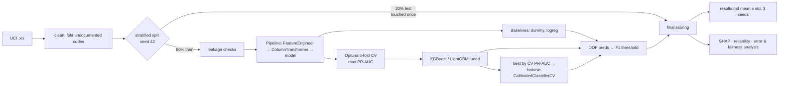
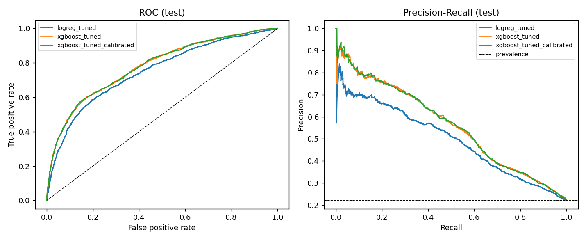
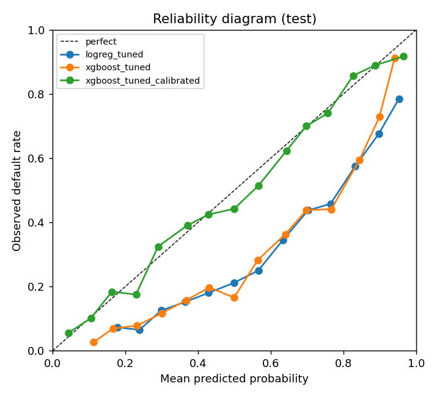
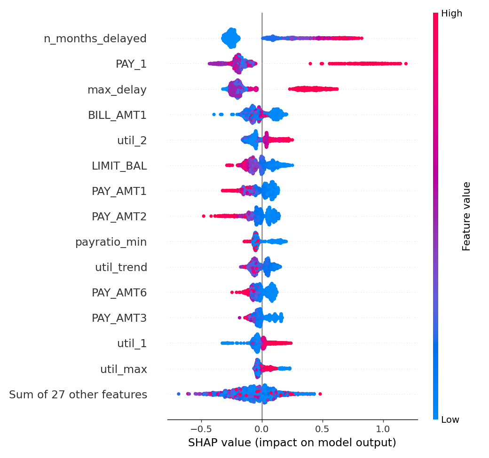

# Credit-risk scoring: leakage-safe, calibrated, fairness-audited


Predict whether a credit-card client **defaults next month** from six months of billing and repayment history. The emphasis is on what production credit models need beyond a high AUC: **no leakage, an honest baseline, calibrated probabilities, explanations, and a fairness audit**.

## Problem and success criteria

| | |
|---|---|
| Task | Binary classification, P(default next month) |
| Primary metric | **PR-AUC** (positive class is the minority) |
| Secondary | ROC-AUC, F1 at an OOF-chosen threshold, Brier, **ECE** (calibration) |
| Baseline to beat | Optuna-tuned logistic regression on the same features |
| Done when | Final model beats the baseline on PR-AUC by more than 1 std over 3 seeds, with ECE ≤ the uncalibrated model's, leakage checks pass, and error analysis and fairness audit are written up |

## Data

[UCI: Default of Credit Card Clients](https://archive.ics.uci.edu/dataset/350/default+of+credit+card+clients) (Yeh & Lien, 2009). Taiwan, April–September 2005. 30,000 clients, 23 features, binary target. **License: CC BY 4.0.** Cite: *Yeh, I. C., & Lien, C. H. (2009). The comparisons of data mining techniques for the predictive accuracy of probability of default of credit card clients. Expert Systems with Applications, 36(2), 2473–2480.*

Run `python scripts/download_data.py` to download the data and print its verifiable stats (rows, positive rate, SHA-256).

**Split:** a stratified 80/20 train/test split with fixed `split_seed=42`, so **every seed and every model is scored on the identical test set**. Tuning, thresholds and calibration use stratified 5-fold CV on train only.

## Approach



- **Features** (row-wise, stateless, so leakage-free by construction): utilisation per month, repayment ratio (`PAY_AMT_k / BILL_AMT_{k+1}`), months delayed, max delay, delay trend, totals relative to the limit.
- **Protected attributes** (SEX, EDUCATION, MARRIAGE, AGE) are **excluded from the model** and used only in the audit. An ablation measures what they would add.
- **Imbalance:** class re-weighting (`class_weight` / `scale_pos_weight`) rather than SMOTE, because synthetic minority rows rarely help GBDTs and they distort probabilities further.
- **Calibration:** re-weighting inflates scores, so the best tuned model is wrapped in 5-fold isotonic `CalibratedClassifierCV`.

## Setup and usage

```bash
python -m venv .venv && source .venv/bin/activate      # Windows: .venv\Scripts\activate
pip install -r requirements.txt -r requirements-dev.txt && pip install -e . --no-deps
python scripts/download_data.py                           # ~5.5 MB
python scripts/run_experiment.py --config configs/smoke.yaml     # few-minute sanity run
python scripts/run_experiment.py --config configs/default.yaml   # full run, 3 seeds × 50 trials
python scripts/error_analysis.py --config configs/default.yaml
pytest && ruff check .
```

`requirements.txt` pins the direct dependencies. `requirements-lock.txt` freezes every package from a verified Python 3.12 environment; use it for exact reproduction (`pip install -r requirements-lock.txt`).

Runs are **resumable**: per-(seed, model) results are appended to `results_per_seed.csv` and Optuna studies persist in SQLite, so you can rerun the same command after a crash. On Kaggle, use `notebooks/kaggle_run.ipynb` (outputs go to `/kaggle/working`). Ablations are listed in [configs/ablations.md](configs/ablations.md).

If the automatic download fails (some networks reset the UCI connection), download the zip manually from the UCI page into `data/raw/` and rerun.

## Results

Copied from `outputs/default/results.md` (full run, 3 seeds, 50 Optuna trials per model). Test set: 6,000 rows, positive rate 0.2212, the same for every seed. Values are mean ± std over seeds 0, 1, 2.

| model | PR-AUC (test) | ROC-AUC | F1 | ECE | Brier | log loss |
|---|---|---|---|---|---|---|
| dummy (prior) | 0.2212 ± 0.0000 | 0.5000 ± 0.0000 | 0.3622 ± 0.0000 | 0.0000 ± 0.0000 | 0.1723 ± 0.0000 | 0.5284 ± 0.0000 |
| logreg_tuned (baseline) | 0.4957 ± 0.0003 | 0.7493 ± 0.0000 | 0.5116 ± 0.0019 | 0.2188 ± 0.0001 | 0.1936 ± 0.0000 | 0.5807 ± 0.0001 |
| lightgbm_tuned | **0.5628 ± 0.0018** | 0.7790 ± 0.0007 | 0.5435 ± 0.0030 | 0.1906 ± 0.0041 | 0.1771 ± 0.0013 | 0.5358 ± 0.0033 |
| xgboost_tuned | 0.5578 ± 0.0004 | 0.7792 ± 0.0011 | 0.5430 ± 0.0027 | 0.2003 ± 0.0043 | 0.1793 ± 0.0009 | 0.5424 ± 0.0023 |
| **xgboost_tuned + isotonic (final)** | 0.5571 ± 0.0011 | **0.7793 ± 0.0009** | **0.5466 ± 0.0025** | **0.0151 ± 0.0035** | **0.1346 ± 0.0000** | **0.4298 ± 0.0015** |

What the numbers say:

- **Tuned GBDTs beat the tuned logistic-regression baseline by about 0.06 PR-AUC** (0.557–0.563 vs 0.496), far more than the seed-to-seed std (≤ 0.002).
- **XGBoost and LightGBM are tied.** Mean out-of-fold PR-AUC on train was 0.56374 vs 0.56369, so the calibrated family was chosen by a coin-flip-sized margin. LightGBM is slightly ahead on test PR-AUC (0.5628 vs 0.5578), which is within noise for model selection; I did not pick by test score.
- **Calibration is the big practical win.** Isotonic calibration cut ECE from 0.200 to 0.015 and log loss from 0.542 to 0.430 at a cost of under 0.001 PR-AUC. Note the uncalibrated models have a *worse* Brier score than the dummy because `scale_pos_weight` inflates their probabilities.
- The final model is selected once (by mean OOF PR-AUC over seeds) and then calibrated on every seed, so its mean ± std is over the same model family.





A snapshot of the run is committed in [reports/](reports/) (results, per-seed rows, error analysis, fairness gaps, figures). A fresh run writes to `outputs/default/`, which is gitignored.

## Error analysis

Full tables: [reports/error_analysis.md](reports/error_analysis.md) (final model, seed 0, threshold 0.298 chosen on OOF F1).

- **It is mostly a "late last month" detector.** Clients who were late last month: recall 0.93, but FPR 0.68. Clients who paid on time: recall only 0.17. The 605 missed defaulters look like good payers (mean PAY_1 −0.41 vs 1.51 for caught ones).
- **Missed defaulters have higher limits (164.7K vs 114.8K) and repaid more of their last bill (51% vs 19%).** Six months of history gives no early warning for these sudden defaults.
- **The most confident false positives are 2–3 months late every month but did not default.** The features cannot separate "always a bit late" from "about to default".
- **Fairness (demographics excluded from inputs):** the TPR gap is 0.012 by sex and 0.071 by age band. Education (0.38) and marriage (0.23) gaps come from tiny "other" groups (n = 82 and 75) and are mostly noise.
- **Low-limit clients (Q1) are flagged 39% of the time vs 11% for Q4,** in line with their base rates (0.30 vs 0.17). Credit limit is an income proxy, so this needs a policy review before any real use.

## Limitations

- One market (Taiwan) in one period (2005, just before a known card-debt crisis), so the model will not transfer to other markets or periods without re-validation.
- No timestamps per client, so the split is random rather than out-of-time. A real deployment needs an out-of-time test.
- Dropping protected attributes does not remove proxy bias. The audit measures gaps but does not mitigate them.
- The F1-optimal threshold is not a business threshold. A real one would come from the cost of a missed default vs a rejected good client.

## Future work

Cost-sensitive threshold from a loss matrix · fairness mitigation (e.g. group-aware thresholds, if allowed) · monotonic constraints on delay features · out-of-time validation on a dated dataset (e.g. Home Credit) · serve with FastAPI in P11.

## Ethics

Credit scoring is a high-stakes use. This model is for learning only. Any real use needs adverse-action explanations, regulatory review (e.g. RBI Fair Practices Code, ECOA/Reg B), and monitoring for drift and disparate impact. The data is anonymised and contains no direct identifiers.
