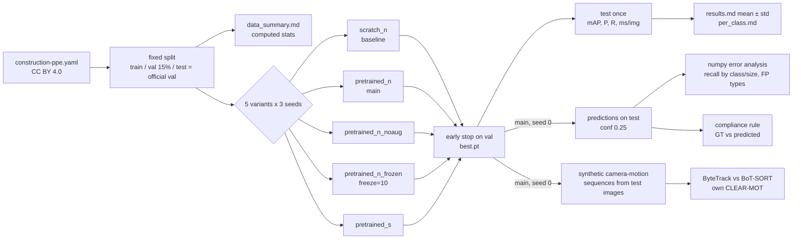

# PPE compliance on construction sites: detection, tracking, per-worker audit


This project detects 12 kinds of personal protective equipment, and the matching "missing PPE" labels, in construction-site photos. It does three things with them:

- a **controlled comparison**: from-scratch vs COCO-pretrained YOLO26, plus three ablations, 3 seeds each
- a **per-person compliance rule** (helmet and vest) built on top of the detections
- a **tracker comparison** (ByteTrack vs BoT-SORT), scored with CLEAR-MOT metrics that I implemented myself

The detection metrics, the error analysis, the compliance check and the MOT metrics are written in plain numpy/scipy and unit-tested. Ultralytics is used only to train and run the models.

## Problem and success criteria

| | |
|---|---|
| Task | object detection, 12 classes: `helmet, gloves, vest, boots, goggles, Person, no_helmet, no_goggle, no_gloves, no_boots, forklift, no_vest` |
| Primary metric | test **mAP50-95** (COCO-style, averaged over IoU 0.50:0.95) |
| Also reported | mAP50, precision, recall, per-class mAP, GPU inference ms/img, parameters |
| Downstream | per-person compliance agreement (the rule on predictions vs the rule on ground truth); MOTA, IDSW, MOTP for tracking |
| Baseline | `scratch_n`: the same YOLO26n architecture, randomly initialised, with identical training settings |
| Protocol | 3 seeds per variant, mean ± std; one fixed train/val split; the test set is evaluated once per run with the best-on-val weights |

## Data

| | |
|---|---|
| Dataset | [Construction-PPE](https://docs.ultralytics.com/datasets/detect/construction-ppe/), loaded through Ultralytics' built-in `construction-ppe.yaml` (downloads automatically) |
| Licence | **CC BY 4.0**: attribution required; commercial use allowed |
| Split | The official `val` split is used as our **test** set. Our val set is 15% of the official train split (`split_seed=42`), so early stopping and `best.pt` selection never see test images. All seeds and variants share the same split. |
| Size (computed) | train **680** images / 10,100 boxes, val **120** / 1,802, test **200** / 2,961. There are no empty images, about 15 boxes per image, and small objects are 17% of test boxes (`no_helmet` 39% small). |
| Statistics | `outputs/ppe/data_summary.md` is **computed** by `ppedet.data.split_stats`. It gives images, empty images, boxes per image, and per-class instances and images with small/medium/large counts. None of these numbers are typed in by hand. |

Privacy: the images show real workers, often with visible faces. They are used here only for training and evaluation. The repo never commits dataset images; `datasets/` is git-ignored.

## Approach



| Variant | Question it answers |
|---|---|
| `scratch_n` (baseline) | How far does the small training split get you with no pretraining? |
| `pretrained_n` (main) | What does COCO transfer learning add? |
| `pretrained_n_noaug` | How much do mosaic, mixup, HSV, flip, scale and translate augmentation help on a small dataset? |
| `pretrained_n_frozen` | Does freezing the first 10 layers (the backbone) cost accuracy, and does it speed training up? |
| `pretrained_s` | Is the larger model worth roughly 3x the parameters and the extra latency? |

**Compliance rule** ([compliance.py](src/ppedet/compliance.py)). For each `Person` box and each item (helmet, vest):

- **violation** if a `no_<item>` box lies at least 50% inside the person box
- **ok** if an `<item>` box lies at least 50% inside the person box and its centre is in the expected vertical band (helmet: top 35% of the person; vest: 15–75%)
- **unknown** otherwise

A violation outranks an ok. The rule outputs "unknown" when the evidence is missing; it does not guess. The rule is scored by applying it to ground-truth boxes and to predicted boxes and comparing the result for each GT person.

**Tracking.** There are no identity-labelled videos, so each sequence is a test image viewed through a crop window that pans and zooms smoothly (30 frames). Boxes that are less than 50% visible are dropped. Ground-truth ids come from the source labels, which makes exact CLEAR-MOT scoring possible. This setup tests camera motion, missed detections and re-association. It does **not** test people walking past each other; see Limitations. `scripts/track_video.py` runs on real footage and writes a per-track compliance CSV (majority vote over the track's frames), with no accuracy claim.

Trade-offs, one recommendation each:

- **YOLO26 over YOLO11/YOLOv8.** It is Ultralytics' current release and NMS-free end to end; Ultralytics reports faster CPU and edge inference at similar accuracy. The latency column checks this on a T4.
- **Nano as the main model.** The `pretrained_s` row checks whether the extra cost pays off. For a site camera on edge hardware, latency matters as much as accuracy.
- **Official val as test, our own val from train.** Selecting `best.pt` on the same images you report on inflates results.
- **Own matching and MOT code** instead of only reading Ultralytics' numbers. Error types and identity switches can't be read off a single mAP, and the code is unit-tested against hand-computed cases.
- **ByteTrack as the default tracker.** It needs no re-ID network and is fast. BoT-SORT adds camera-motion compensation (GMC), which should matter here, and the comparison measures whether it does.

Recent API notes: YOLO26 weights are `yolo26n.pt` / `yolo26s.pt`, and `model.train(...)` returns metrics, with the best checkpoint at `model.trainer.best`. `model.val(split="test")` needs a `test:` key in the data YAML, which `ppe_split.yaml` provides. `model.track(..., persist=True)` keeps tracker state between calls, so a fresh `YOLO` object is created per sequence to reset ids.

## Repository structure

```
03-ppe-safety-vision/
├── configs/            ppe.yaml (5 variants x 3 seeds), smoke.yaml (1 epoch pipeline check)
├── src/ppedet/
│   ├── config.py       dataclass config + --set overrides + validation
│   ├── data.py         dataset location, fixed split, computed statistics
│   ├── boxes.py        IoU/IoA, size buckets, greedy class-aware matching + FP typing
│   ├── evaluate.py     error analysis, compliance agreement, mean ± std tables
│   ├── compliance.py   per-person helmet/vest rule
│   ├── sequences.py    synthetic pan/zoom sequences with exact GT ids
│   ├── mot.py          CLEAR-MOT (MOTA, MOTP, IDSW, FP, FN)
│   ├── train.py        Ultralytics train / test / predict wrapper (lazy import)
│   ├── track.py        tracker comparison
│   ├── experiment.py   resumable end-to-end runner
│   └── app.py          Gradio demo
├── scripts/            run_experiment.py, track_video.py, make_notebook.py
├── tests/              36 CPU tests, no ultralytics or torch needed
├── notebooks/          kaggle_run.ipynb (generated, thin wrapper)
├── reports/            committed snapshot of the final run
└── docs/               INTERVIEW.md, DEMO_SCRIPT.md, CAREER.md
```

## Setup and usage

```bash
python -m venv .venv && .venv\Scripts\activate           # or source .venv/bin/activate
pip install -r requirements.txt -r requirements-dev.txt && pip install -e . --no-deps
python scripts/run_experiment.py --config configs/smoke.yaml   # ~5 min pipeline check, numbers not reportable
python scripts/run_experiment.py --config configs/ppe.yaml     # full run, ~4-5 h on a T4
pip install -r requirements-demo.txt                            # Gradio demo only (see the note below)
python -m ppedet.app --weights outputs/ppe/runs/pretrained_n_s0/weights/best.pt
python scripts/track_video.py --weights <best.pt> --video site.mp4
pytest && ruff check .
```

Any config value can be overridden, for example `--set train.epochs=10 "seeds=[0]"`. Runs are **resumable**: finished (variant, seed) rows in `results.jsonl` are skipped, an interrupted run resumes from `last.pt`, and the error-analysis and tracking stages are skipped once their outputs exist.

**Kaggle** (how the reported numbers were produced): open `notebooks/kaggle_run.ipynb` with a T4 GPU and Internet on, then Save & Run All. It writes `env.txt` (the exact ultralytics/torch versions, used to pin `requirements.txt`) and `p3_results.zip` (text results plus the main run's plots). The main model's weights are a separate output file. Unzip the archive into `outputs/` and copy it into `reports/`. The notebook is generated by `scripts/make_notebook.py`.

Reproducibility: the seed is passed to Ultralytics with `deterministic=True`, and the split is fixed. GPU kernels are still not bit-exact, so expect small seed-to-seed spread. That spread is why the tables report std.

`requirements-demo.txt` holds Gradio and nothing else. The demo app has never been run locally, so there is no version to pin; it is kept out of `requirements.txt` rather than left as an unpinned line inside a pinned file.

## Results

Kaggle T4, ultralytics 8.4.216, torch 2.11.0+cu130 (`reports/kaggle_t4/env.txt`). 50 epochs, imgsz 640, batch 16, patience 15. Test split: 200 images, 2,961 boxes. Every row is the mean ± std over 3 seeds (`reports/kaggle_t4/results.md`), and latency is the Ultralytics inference time per image on the T4.

| variant | test mAP50-95 | mAP50 | precision | recall | ms/img (T4) | params (M) |
|---|---|---|---|---|---|---|
| scratch_n (baseline) | 0.227 ± 0.008 | 0.449 ± 0.007 | 0.653 ± 0.060 | 0.425 ± 0.010 | 4.3 ± 1.2 | 2.51 |
| **pretrained_n (main)** | **0.529 ± 0.003** | **0.747 ± 0.004** | 0.850 ± 0.001 | 0.687 ± 0.004 | 4.0 ± 0.3 | 2.54 |
| pretrained_n_noaug | 0.471 ± 0.002 | 0.695 ± 0.007 | 0.811 ± 0.012 | 0.642 ± 0.007 | 4.1 ± 0.6 | 2.54 |
| pretrained_n_frozen | 0.514 ± 0.002 | 0.729 ± 0.003 | 0.826 ± 0.002 | 0.671 ± 0.007 | 4.0 ± 0.0 | 2.54 |
| pretrained_s | 0.595 ± 0.001 | 0.810 ± 0.004 | 0.892 ± 0.004 | 0.755 ± 0.005 | 8.8 ± 0.4 | 9.96 |

What the ablations show:

- **COCO pretraining matters most.** It takes mAP50-95 from 0.227 to 0.529 (×2.3) under the same 50-epoch budget. The scratch model is still improving at the end: its val mAP50-95 rises 0.159 → 0.201 → 0.216 at epochs 24, 39 and 49 (`reports/kaggle_t4/runs/scratch_n_s0/results.csv`). Part of this gap is therefore under-training.
- **Augmentation is worth 0.058 mAP50-95** (0.529 → 0.471 without it). With 680 training images, the default mosaic/HSV/flip augmentation acts as the main regulariser.
- **Freezing the backbone (first 10 layers) costs only 0.015.** That is a cheap option when GPU time is the constraint.
- **The larger `s` model** gains 0.066 mAP50-95 for 3.9× the parameters and 2.2× the latency. `n` is the main model because the target is edge cameras; `s` is the choice if a T4-class server is available.

Per-class test mAP50-95 for the main model (`reports/kaggle_t4/per_class.md`):

- Best classes: Person 0.780, vest 0.695 and helmet 0.637.
- Weakest classes: the "absence" classes, no_goggle 0.073, no_gloves 0.386 and no_helmet 0.388.

Tracking (`reports/kaggle_t4/tracking.md`) uses the main model on the synthetic test sequences (camera motion plus dropped detections), scored with our own CLEAR-MOT implementation:

| tracker | scope | MOTA | IDSW | MOTP (IoU) |
|---|---|---|---|---|
| ByteTrack | Person | 0.983 | 0 | 0.943 |
| BoT-SORT | Person | 0.983 | 0 | 0.965 |
| ByteTrack | all classes | 0.742 | 7 | 0.885 |
| BoT-SORT | all classes | 0.759 | 15 | 0.893 |

On persons the two trackers tie on MOTA, and BoT-SORT boxes fit slightly tighter. On all classes BoT-SORT has higher MOTA (fewer FN: 544 vs 709) but twice the identity switches. **ByteTrack is the default**, since stable IDs matter more than a few recovered small boxes for per-person compliance, and it has no camera-motion-compensation cost. The synthetic sequences are easy (no occlusion between people), so these numbers are an upper bound.

## Error analysis

`reports/kaggle_t4/error_analysis.md` covers the main model (seed 0, conf ≥ 0.25, IoU ≥ 0.5).

- **Small objects are the main failure.** Recall is 0.174 on small boxes (< 32² px, 511 GT), 0.672 on medium and 0.950 on large. Most small test boxes are boots (123), helmets (91), no_helmet (69), no_gloves (63) and gloves (53), all seen from far away. Fixes, in order of cost: train at imgsz 960–1280, tile inference (SAHI-style), or use a P2 detection head.
- **"Absence" classes are confused with their "presence" twin.** The top class confusions are no_boots→boots (36), no_helmet→helmet (14), no_vest→vest (13) and no_gloves→gloves (7). The detector localises the body part but gets the state wrong, which is the dangerous direction for safety (a violation reported as compliant).
- **no_goggle is nearly unlearnable here.** It has 223 train instances, almost none large, and recall is 0.220. 12 of its 14 FPs are localisation errors (right class, IoU < 0.5 with the small GT box). More data or merging it into a "face PPE" check is more realistic than tuning.
- **Boots carry the most false positives** (37 localisation, 37 class). Feet are small and often overlap.
- **Compliance rule (GT vs predicted, 481 GT persons): agreement 0.696.**
  - Of 227 non-compliant persons, 138 are caught. 47 become "unknown", 28 are missed persons and 14 (6%) are wrongly called compliant.
  - Of 230 compliant persons, only 6 are flagged as violations.
  - The rule fails "safe-ish": it mostly says "unknown", not "compliant". A deployment should route "unknown" to a human rather than treat it as OK.

## Limitations

- The test set is small (200 images), so per-class numbers for rare classes have high variance. Read the per-class `GT` column before trusting a per-class recall.
- The synthetic sequences have rigid scenes and no person-to-person occlusion. They measure robustness to camera motion and missed detections, not crowd tracking, and real video will be harder.
- The compliance rule is a geometric heuristic. A helmet held at chest height, or two overlapping workers, can fool it. "Unknown" is common when items are small or occluded.
- From-scratch training gets the same epoch budget as fine-tuning, so the baseline gap partly reflects under-training. The comparison is "equal budget", not "scratch at convergence".

## Licences and ethics

- **Code licence: AGPL-3.0.** Ultralytics is AGPL-3.0, and this project imports and fine-tunes its models, so the project is released under the same terms. A closed-source product would need an Ultralytics Enterprise licence. The YOLO26 COCO weights fall under the same terms.
- **Data: CC BY 4.0.** Credit the Construction-PPE dataset (Ultralytics) whenever the data or derived models are shared.
- **Surveillance risk.** PPE detection is easily turned into worker monitoring. Use it as a safety aid with a human in the loop: alerts go to a site safety officer, not into automated discipline. Workers should be told that cameras are in use, and the system should keep aggregate statistics rather than per-person records.
- **Privacy.** Video contains faces. A real deployment should process on the device, keep no raw footage (or blur faces before storing anything), and follow local law (e.g. GDPR, or India's DPDP Act 2023).
- **Failure cost.** A missed `no_helmet` is worse than a false alarm. Consider the operating threshold with that asymmetry in mind, and the per-class recall table shows where the model is weakest.
