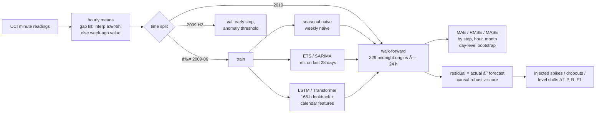
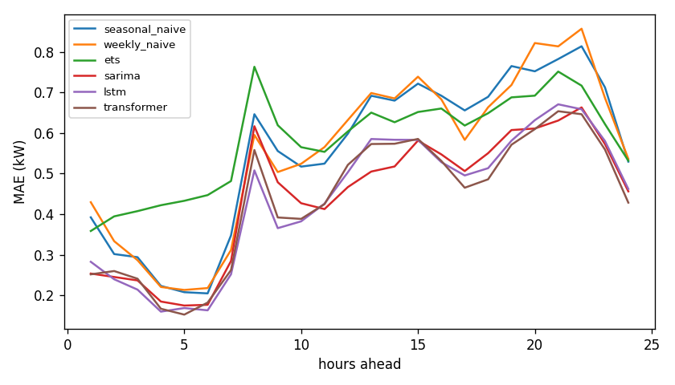
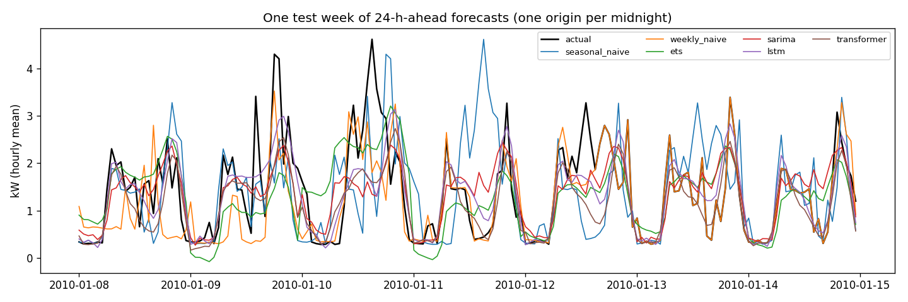

# P5: Household electricity load forecasting + anomaly detection


Forecasting the next 24 hours of one household's electricity load. The models are two naive baselines, ETS, SARIMA, an LSTM and a small Transformer. All of them are evaluated with the same walk-forward backtest over a full year, and the forecast residuals are reused to detect injected anomalies.

**Headline (real Kaggle run, 329 forecast days of 2010):**
- The Transformer has the lowest MAE: 0.437 ± 0.000 kW over 3 seeds.
- The LSTM gets 0.438 ± 0.003 and SARIMA 0.446. All three beat seasonal naive (0.554) by about 20%, and the bootstrap CIs exclude 0.
- **The three are statistically indistinguishable** (see the head-to-head table). SARIMA has the lowest RMSE.
- I recommend the LSTM because it matches the Transformer's accuracy with 5× less training time.
- For anomaly detection, forecast residuals find 85–95% of injected events, against 53% for a raw z-score. The raw z-score misses every dropout.
- Precision stays low (0.14–0.19), so this is a triage signal, not an alarm.

---

## A. Problem and metrics

- **Task:** given all load up to midnight, forecast each hour of the next day (horizon 24 h, one origin per day). This is the day-ahead setting used for scheduling and tariffs.
- **Target:** `Global_active_power` (kW), averaged per hour.
- **Primary metric: MAE (kW).** It is in the unit a user sees, and the same error counts the same at night and at peak.
- **Also reported:**
  - RMSE, which punishes peak misses.
  - MASE: MAE divided by the in-sample MAE of the 24-h seasonal naive on train, so 1.0 means "as good as copying yesterday in training". MASE is scale-free across households.
  - MAE by horizon step, by hour, by weekday/weekend and by month.
  - Cost: training time and prediction ms per origin.
- **Significance:** a paired bootstrap over forecast **days**. It resamples whole days, because the 24 hours within a day are correlated.
- **Anomalies:** precision, recall and F1 per hour, plus event recall (was any hour of the event flagged), recall per event type, and false alarms per week.

## B. Dataset, licence, split

**Data:** [UCI Individual Household Electric Power Consumption](https://archive.ics.uci.edu/dataset/235/individual+household+electric+power+consumption) (Hébrail & Bérard, 2006). It holds one-minute readings from one house near Paris, Dec 2006 to Nov 2010, under a **CC BY 4.0** licence. It is downloaded at run time and never committed.

**Cleaning** (counts computed by `data.py`, from the run):
- 25,979 of 2,075,259 minute readings were missing (1.25%).
- After resampling to hourly means, 421 hours had no reading at all:
  - 1 was linearly interpolated (gap ≤ 6 h);
  - 420 were filled with the value from one week earlier.
 
- The final series has 34,560 hours, from 2006-12-17 to 2010-11-25.

**Split (by time; nothing after an origin is visible to a model):**

| split | hours | start | end | mean kW | std kW | p95 kW |
|---|---|---|---|---|---|---|
| train | 22,248 | 2006-12-17 | 2009-06-30 | 1.118 | 0.944 | 2.994 |
| val | 4,416 | 2009-07-01 | 2009-12-31 | 1.007 | 0.831 | 2.657 |
| test | 7,896 | 2010-01-01 | 2010-11-25 | 1.052 | 0.782 | 2.571 |

Train peak hour is 20:00 and trough is 03:00. Autocorrelation at lag 1 / 24 / 168 h: 0.718 / 0.425 / 0.453, so the weekly lag carries slightly more signal than the daily one.

- Validation is used only for neural early stopping and for picking the anomaly threshold.
- **Test is a walk-forward backtest:** 329 origins, one per midnight in 2010, each forecasting the next 24 h. The statistical models are re-fit on the 28 days before each origin. The neural models train once, on data before 2010, and then read the actual history up to each origin.

**Privacy and ethics:** household load at hourly resolution reveals occupancy (when people wake, leave and go on holiday; see the low-load August and the 2010-02-28 day below). The data is public and anonymised to one unnamed house. A real deployment would need consent, aggregation or coarser resolution, and the same care for anomaly alerts, which effectively report on people's behaviour.

## C. Approach



| model | what it is | why it's here |
|---|---|---|
| seasonal naive | y(t) = y(t − 24 h) | **Baseline.** Anything that cannot beat "same as yesterday" is not worth deploying. |
| weekly naive | y(t) = y(t − 168 h) | Tests whether the weekly cycle beats the daily one. |
| ETS | Holt-Winters, additive daily season, fit on the last 28 days | Classic exponential smoothing. |
| SARIMA | (2,0,1)(1,1,1)â‚‚â‚„, last 28 days, parameters re-estimated every 7 folds | The strongest classical baseline. |
| LSTM | 2 layers, 64 hidden, 168-h lookback + hour/weekday features → 24 outputs at once (direct multi-output) | Small learned model; 53k params. |
| Transformer | 2-layer encoder, d=64, 4 heads, same inputs and outputs | Tests whether attention beats recurrence here; 114k params. |

The neural models use an L1 loss (which matches MAE), AdamW, early stopping on val MAE with patience 5, and a maximum of 30 epochs. Each runs 3 seeds. The naive, ETS and SARIMA models are deterministic and run once.

**Trade-offs (one recommendation each):**
- **Direct 24-output head vs recursive one-step:** direct, because recursive forecasts feed their own errors back over 24 steps.
- **Train neural once vs re-train per origin:** once, because 329 re-trainings would cost about 300 CPU-hours for the Transformer alone. History is still updated at every origin.
- **SARIMA re-estimated every 7 folds:** keeps the cost to about 11 minutes. Re-filtering between refits still uses the newest data.
- **No Prophet:** its trend + Fourier seasonality covers the same ground as ETS/SARIMA here, and it adds a Stan toolchain dependency for no new idea.
- **MAE as the primary metric:** squared error is dominated by a few evening peaks. RMSE is still reported, because it ranks the models differently (see below).
- **Anomaly evaluation on injected events:** the dataset has no anomaly labels, so known events are injected and recovered. This measures detectability, not real-world precision.

## D. Repo structure

```
05-energy-forecasting/
├── configs/
│   ├── household_power.yaml   # full run (the results below)
│   └── smoke.yaml             # synthetic series, runs in seconds
├── src/tsforecast/
│   ├── data.py         # download, minute→hour, gap filling, split stats
│   ├── backtest.py     # walk-forward origins; history strictly before each origin
│   ├── models_stat.py  # seasonal/weekly naive, ETS, SARIMA
│   ├── models_nn.py    # LSTM, Transformer (direct 24-h head)
│   ├── metrics.py      # MAE/RMSE/MASE, breakdowns, day-level paired bootstrap
│   ├── anomaly.py      # event injection, causal robust z, threshold search
│   ├── experiment.py   # runs models + anomaly + writes reports (resumable)
│   ├── config.py, utils.py
├── scripts/run_experiment.py, scripts/make_notebook.py
├── notebooks/kaggle_run.ipynb   # clones the repo and calls the package only
├── tests/                       # 23 tests: leakage, metrics, models, anomaly, pipeline
└── reports/kaggle_cpu/          # committed snapshot of the run below
```

## E. How to run

```bash
# from 05-energy-forecasting/ (D-drive env: uv venv -q --python 3.13 --system-site-packages .venv)
pip install -r requirements.txt && pip install -e . --no-deps
pytest -q && ruff check .
python scripts/run_experiment.py --config configs/smoke.yaml                 # synthetic series, quick check
python scripts/run_experiment.py --config configs/household_power.yaml       # full run, ~3.5 h on CPU
python scripts/run_experiment.py --config configs/household_power.yaml --set "models=[seasonal_naive,sarima]"
```

The run is resumable: finished (model, seed) pairs in `results.jsonl` are skipped. The results below come from `notebooks/kaggle_run.ipynb` on Kaggle.

**Environment note:** the kernel had no GPU attached, so everything ran on a 2.20 GHz Xeon CPU and the training times below are CPU times. Its preinstalled versions differed from the pins in `requirements.txt`:

| package | Kaggle | pinned |
|---|---|---|
| torch | 2.11.0+cpu | 2.11.0 |
| pandas | 2.3.3 | 2.3.3 |
| statsmodels | 0.15.0 | 0.15.0 |
| numpy | 2.1.3 | 2.5.2 |
| scipy | 1.16.3 | 1.18.0 |

The full run completed with these versions; full list: `reports/kaggle_cpu/versions.json`.

## F. Results (walk-forward test, 329 days × 24 h)

| model | MAE (kW) | RMSE (kW) | MASE | seeds |
|---|---|---|---|---|
| seasonal naive (baseline) | 0.5541 | 0.8189 | 0.810 | 1 |
| weekly naive | 0.5549 | 0.8162 | 0.811 | 1 |
| ETS | 0.5794 | 0.7739 | 0.847 | 1 |
| SARIMA | 0.4462 | **0.6221** | 0.652 | 1 |
| LSTM | 0.4382 ± 0.0033 | 0.6376 ± 0.0060 | 0.641 ± 0.005 | 3 |
| Transformer | **0.4369 ± 0.0000** | 0.6295 ± 0.0055 | **0.639 ± 0.000** | 3 |

On the Transformer's ± 0.0000: the per-seed MAEs were 0.4369 / 0.4369 / 0.4370, while their RMSEs differ (0.6327 / 0.6232 / 0.6325). The seeds produced different forecasts with almost the same mean absolute error.

**vs seasonal naive** (paired bootstrap over days, first seed; negative = better):

| model | ΔMAE (kW) | 95% CI | share of days better |
|---|---|---|---|
| weekly naive | +0.0008 | [−0.027, +0.027] | 47% |
| ETS | +0.0253 | [+0.001, +0.053] | 49% |
| SARIMA | −0.1079 | [−0.126, −0.092] | 78% |
| LSTM | −0.1149 | [−0.134, −0.098] | 73% |
| Transformer | −0.1172 | [−0.137, −0.100] | 76% |

**Head-to-head among the top three** (paired bootstrap over the 329 test days, 2,000 resamples; difference = MAE(b) − MAE(a), negative means b is better; full table in [`reports/kaggle_cpu/head_to_head.md`](reports/kaggle_cpu/head_to_head.md), produced by `python scripts/head_to_head.py`):

| a | b | seed 0 | seed 1 | seed 2 |
|---|---|---|---|---|
| SARIMA | Transformer | −0.0093 [−0.0219, +0.0033] | −0.0093 [−0.0206, +0.0032] | −0.0092 [−0.0210, +0.0034] |
| SARIMA | LSTM | −0.0070 [−0.0202, +0.0070] | −0.0053 [−0.0189, +0.0093] | −0.0117 [−0.0251, +0.0019] |
| LSTM | Transformer | −0.0023 [−0.0109, +0.0067] | −0.0040 [−0.0106, +0.0024] | +0.0024 [−0.0046, +0.0093] |

Every 95% CI includes 0: on this test year, the three models are statistically tied for any single seed. The neural model has the lower MAE on only 52–56% of days. Averaging the three seeds' forecasts (no weights, no tuning on the test period) does separate them: the LSTM ensemble reaches MAE 0.4295 (−0.0167 vs SARIMA, CI [−0.0298, −0.0030]) and the Transformer ensemble 0.4278 (−0.0185, CI [−0.0304, −0.0064]). Note that ensembling triples training and inference cost.

**MAE by horizon step** (the origin is midnight, so step *h* is clock hour *h*−1):

| model | h=1 | h=6 | h=12 | h=18 | h=24 |
|---|---|---|---|---|---|
| seasonal naive | 0.392 | 0.205 | 0.598 | 0.689 | 0.529 |
| SARIMA | 0.254 | 0.177 | 0.467 | 0.550 | 0.456 |
| LSTM | 0.283 | 0.163 | 0.503 | 0.513 | 0.462 |
| Transformer | 0.252 | 0.183 | 0.522 | 0.486 | 0.429 |




**Cost (Kaggle CPU):**

| model | params | train time per seed | predict per origin | best epoch |
|---|---|---|---|---|
| naive | – | – | <0.1 ms | – |
| ETS | – | refit per origin | 73 ms | – |
| SARIMA | – | refit per origin (11 min total) | 1,987 ms | – |
| LSTM | 53k | 519–808 s | 2.4–2.6 ms | 12–22 |
| Transformer | 114k | 3,166–3,405 s | 2.2–3.4 ms | 9–10 |

**Reading the table:**
1. **All three good models beat the baseline by about 20%,** with CIs well clear of 0. SARIMA, the LSTM and the Transformer are within 0.01 kW of each other.
2. **The ranking depends on the metric.** The Transformer has the best MAE, SARIMA the best RMSE. SARIMA's errors are smaller at the extremes. A likely reason: the neural models are trained with L1, so they target the median and under-shoot rare peaks.
3. **ETS is worse than copying yesterday on MAE** (+0.025, CI excludes 0), yet better on RMSE. It smooths: at 03:00–05:00 its MAE is about 0.43 vs 0.21 for naive, because it forecasts a blurred day. At the evening peak it is safer than a naive copy.
4. **Weekly naive = seasonal naive,** even though lag-168 autocorrelation is slightly higher. In practice, "last Tuesday" is no better a guess than "yesterday".
5. **The horizon curve is the daily cycle, not error growth.** Step 6 (05:00) is the easiest for every model and step 18 (17:00) one of the hardest. Since every origin is midnight, step and clock hour are the same thing, so this design cannot separate horizon decay from time-of-day difficulty.

**Recommendation:** use the **LSTM**. It is within noise of the Transformer, trains about 5× faster on CPU (≈11 vs ≈54 min per seed) with half the parameters, and predicts in about 2.5 ms against 2 s for SARIMA. If no training infrastructure is available, SARIMA reaches the same tier with no learned weights.

## G. Error analysis (Transformer, the lowest-MAE model; full tables in `reports/kaggle_cpu/error_analysis.md`)

**By hour of day:**
- Error follows usage. The best hours are 03:00–05:00 (MAE 0.15–0.18 kW). The worst are 19:00–21:00 (0.61–0.65), when the household cooks and uses appliances at times that vary day to day.
- 07:00 is a sharp single-hour spike (0.56 vs 0.26 at 06:00): the wake-up time shifts, and a 1-hour shift of a steep ramp costs a lot.
- The LSTM is best at 07:00–08:00 (0.51 / 0.37 kW). The Transformer is lowest in most evening hours (16:00–19:00 and 21:00–23:00), SARIMA at 20:00.

**Weekday vs weekend:** weekend MAE is 0.503 vs 0.411 on weekdays, for every model. Weekends are less routine, and each one is only 2 of 7 training days.

**By month:**

| | best month | worst months |
|---|---|---|
| Transformer | Aug 2010, 0.276 | Jan–Feb, 0.52–0.53 |
| seasonal naive | 0.259 | – |

In August the load is low and flat (a likely holiday period), so even seasonal naive is hard to beat; it is the only month where naive wins. Winter has the highest and most variable load (heating, lighting).

**Worst 8 days:**
- Daily MAE has median 0.413, p90 0.657 and p99 0.929 kW. The worst day is 1.136 kW, on 2010-11-04.
- Seven of the 8 worst days have a mean load of 1.4–1.9 kW, well above the test mean of 1.05. These are unusually heavy days the model under-predicts.
- **2010-02-28 is the reverse:** mean load 0.494 kW, under half the norm, and the model over-predicts. The house was probably empty.
- On 6 of the 8 worst days, seasonal naive was no better (MAE 0.89–1.25). These days are hard for every model, not a neural failure.

**Takeaway:** the remaining error is mostly behaviour the history cannot predict: when people cook, go away, or have guests. Next steps:
- weather (temperature drives heating);
- holiday and school-calendar features;
- a quantile head (P10/P50/P90), so that the peaks become an interval instead of a miss.

## H. Anomaly detection (injected events on the test year)

The data has no labels, so 40 events are injected into each of the validation and test periods:
- **spike:** 1–2 h, +3–6σ;
- **dropout:** 3–12 h at ~0 kW;
- **level shift:** 6–24 h, ±1.5–3σ.

Each hour gets a **causal robust z-score** of a residual: the median and MAD of the previous window, so no future data is used. The threshold is chosen on the validation injection and then frozen.

| detector (residual of) | z | precision | recall | F1 | event recall | spikes | dropouts | level shifts | false alarms / week |
|---|---|---|---|---|---|---|---|---|---|
| raw value (no model) | 3.0 | 0.182 | 0.247 | 0.210 | 0.525 | 0.93 | **0.00** | 0.62 | **7.0** |
| seasonal naive | 2.5* | 0.143 | 0.407 | 0.212 | **0.950** | 1.00 | 0.92 | 0.92 | 15.3 |
| weekly naive | 2.5* | 0.142 | 0.464 | 0.217 | 0.900 | 1.00 | 0.69 | 1.00 | 17.6 |
| LSTM forecast | 3.0 | **0.194** | 0.390 | **0.259** | 0.850 | 1.00 | 0.62 | 0.92 | 10.1 |

\* 2.5 is the lowest value in the threshold grid, so the true optimum may be lower. The run logged a warning for this.

- **A forecast turns invisible events into visible ones.** A raw z-score finds **zero** dropouts: ~0 kW is a normal value at night. Against a forecast, "0 kW when 1.5 kW was expected" stands out. Event recall rises from 0.53 to 0.85–0.95.
- **The LSTM detector has the best F1 and the fewest false alarms** among the residual detectors (10/week vs 15–18). Its better forecast leaves less normal variation in the residual.
- **None of this is deployable as an alarm.** Even the best detector has precision 0.19, about 10 false alarms a week. It would work as a daily "review these hours" list, or combined with a duration rule (for example, flag only ≥3 consecutive hours, which suits dropouts and level shifts).
- Event recall is computed over 40 events (about 13 per type), so each per-type number is ±1 event ≈ ±0.08.

## I. Limitations

- **One household**, so the conclusions are about this house. The same code would need a multi-household dataset to say anything general.
- **Single test year, single split.** The seed spread covers neural training noise, not split noise. The day-level bootstrap covers sampling of days.
- **No exogenous data** (weather, holidays), which is the obvious next gain.
- **The neural models are trained once** on data up to mid-2009. Re-training monthly might help in late 2010.
- The anomaly results are for synthetic events. Real faults may look different.

## Docs

- [Interview Q&A](docs/INTERVIEW.md)
- [60-second demo script](docs/DEMO_SCRIPT.md)
- [Resume bullet / LinkedIn / repo name](docs/CAREER.md)

**Citation:** Hébrail, G. & Bérard, A. (2006). *Individual Household Electric Power Consumption* [Dataset]. UCI Machine Learning Repository. https://doi.org/10.24432/C58K54
