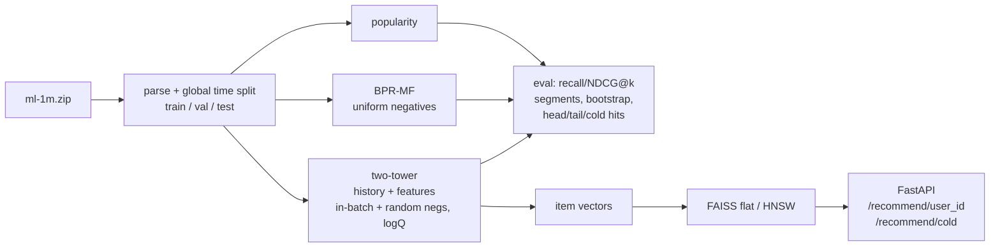

# MovieLens-1M retrieval: popularity vs BPR-MF vs a two-tower, FAISS + FastAPI


This project recommends movies a user will like next. It compares three model families on a **time-based split**, so every model is scored on the future: a popularity baseline, BPR matrix factorisation and a two-tower model with user/item features and corrected negative sampling. Ablations show what each part of the two-tower is worth. The item vectors are served through a FAISS index behind a FastAPI service, which also handles brand-new users from a few liked movies.

**Headline (honest) result:** on this split the two-tower model does **not** beat BPR-MF or even popularity on recall@20. It does recommend about 6× more of the catalogue than popularity and finds more long-tail hits. The ablations show which parts matter (logQ correction: +0.043 recall@20; side features: +0.012).

## Problem and success criteria

| | |
|---|---|
| Task | top-k recommendation from implicit feedback: rating ≥ 4 = "liked" |
| Primary metric | **recall@20** on the test period, averaged over users with at least one liked test item |
| Also reported | recall@10/50, NDCG@10/20, catalogue coverage@20, tail share@20 (share of recommendations outside the top-10% items), cold-item recall, recall by user-activity segment, FAISS recall vs exact search and latency |
| Ranking rule | every item the user rated before the cutoff (any rating) is removed from the ranking |
| Baselines | `popularity` (train positives, log-scaled) and `bpr_mf` (BPR matrix factorisation, dim 64) |
| Main model | `two_tower`: user tower = mean of the last 30 liked items + gender/age/occupation; item tower = genres + release decade (+ ID); in-batch and 256 random negatives, logQ correction, temperature 0.05 |
| Protocol | 3 seeds, mean ± std. Early stopping on val recall@20. Paired bootstrap over test users (1,000 resamples) for model differences. |

## Data

| | |
|---|---|
| Dataset | [MovieLens-1M](https://grouplens.org/datasets/movielens/1m/) (GroupLens), downloaded on the first run |
| Licence | **Research use only, no redistribution, no commercial use.** The repo contains no MovieLens data: `data/` and `outputs/` (including `serve/meta.json`, which holds titles and per-user history) are git-ignored. Cite Harper & Konstan (2015) when you publish results. |
| Size (computed) | 6,040 users, 3,883 movies, 1,000,209 ratings (density 4.3%), 575,281 positives |
| Split | **global temporal**: train = before 2000-12-02, val = up to 2000-12-29, test = after. Train 800,164 / val 100,024 / test 100,021 ratings. Test has 1,188 users with a liked item; 195 of them have no train ratings at all; 50 test positives are on movies with no train ratings. |
| Statistics | `data_summary.md` is computed by `movierec.data.summary`; no number here is typed in by hand. |

Why a global time split and not leave-last-out: a random or per-user split lets a model train on ratings made *after* the ones it is tested on, which inflates scores. The cost is a hard test set: it is small, and many test users are cold.

Privacy: ML-1M users are anonymous IDs with gender, age bucket, occupation and zip code. I do not use zip codes. Gender and age are used as features, so the error analysis checks segments; a real system would need a fairness review before using protected attributes.

## Approach



Trade-offs (one recommendation each):

- **BPR-MF as the learned baseline, not ALS:** it optimises a ranking loss directly with the same negative-sampling machinery as the two-tower, so the comparison isolates features and the loss correction.
- **Two-tower over pure MF for serving:** the user tower takes a history of item IDs and demographics, so it can score a brand-new user without retraining. MF can only fall back to popularity.
- **logQ correction on in-batch negatives:** popular items appear as negatives more often, so without the correction the model learns to push them down. The ablation below shows how big this effect is.
- **HNSW with ef=32 for serving:** 0.990 recall vs exact search at about half the flat-index latency. At 3,883 items a flat index is also fine; HNSW is there to show the trade-off.

## Repository structure

```
06-two-tower-recsys/
├── configs/            ml1m.yaml (full run), smoke.yaml (synthetic data, CI)
├── src/movierec/
│   ├── config.py       dataclass configs + validation
│   ├── data.py         download, parsing, features, temporal split, synthetic data for tests
│   ├── models.py       Popularity, BPR-MF, TwoTower (+ ablations), training loop
│   ├── metrics.py      top-k with exclusion, recall/NDCG, coverage, tail share, paired bootstrap
│   ├── index.py        numpy / FAISS flat / HNSW index + benchmark
│   ├── experiment.py   runs every model x seed, writes reports, exports serve/
│   └── service.py      FastAPI app
├── scripts/            run_experiment.py, make_notebook.py
├── notebooks/          kaggle_run.ipynb (thin wrapper)
├── reports/kaggle_t4/  the reports from the run below
├── tests/              17 tests on synthetic data (+1 FAISS test skipped without faiss)
└── docs/               INTERVIEW.md, DEMO_SCRIPT.md, CAREER.md
```

## Commands

```bash
uv venv --python 3.13 .venv && uv pip install -r requirements.txt -r requirements-dev.txt -e . --no-deps
pip install -r requirements-gpu.txt   # optional: faiss exact search; numpy is the fallback
python scripts/run_experiment.py --config configs/ml1m.yaml           # all models x 3 seeds, resumable
python scripts/run_experiment.py --config configs/smoke.yaml          # 1-minute synthetic run
MOVIEREC_SERVE_DIR=outputs/ml1m/serve uvicorn movierec.service:app    # serve the seed-0 two-tower
pytest && ruff check .
```

```bash
curl "localhost:8000/recommend/1?k=10"
curl -X POST localhost:8000/recommend/cold -H "content-type: application/json" \
     -d '{"gender":"F","age":25,"occupation":3,"liked_movie_ids":[1,2355,3114],"k":10}'
```

The results below come from a Kaggle run (`notebooks/kaggle_run.ipynb`, Tesla T4, torch 2.11.0+cu130, faiss 1.16.0, numpy 2.1.3, scipy 1.16.3, fastapi 0.141.1). The pins in `requirements.txt` are the versions in my local env; the Kaggle image versions differ slightly and are listed in [`reports/kaggle_t4/env.txt`](reports/kaggle_t4/env.txt).

## Results

Test period, 1,188 users, mean ± std over seeds 0, 1, 2. Raw tables: [`reports/kaggle_t4/`](reports/kaggle_t4/).

| model | recall@10 | recall@20 | recall@50 | NDCG@10 | NDCG@20 | coverage@20 | tail share@20 |
|---|---|---|---|---|---|---|---|
| popularity | 0.057 ± 0.000 | 0.092 ± 0.000 | 0.181 ± 0.000 | **0.217 ± 0.000** | **0.204 ± 0.000** | 0.058 | 0.000 |
| bpr_mf | **0.057 ± 0.002** | **0.097 ± 0.002** | **0.191 ± 0.002** | 0.209 ± 0.013 | 0.200 ± 0.010 | 0.257 ± 0.110 | 0.123 ± 0.096 |
| two_tower | 0.053 ± 0.004 | 0.088 ± 0.005 | 0.166 ± 0.009 | 0.173 ± 0.006 | 0.168 ± 0.006 | 0.339 ± 0.013 | 0.242 ± 0.017 |
| two_tower, no features | 0.044 ± 0.002 | 0.076 ± 0.002 | 0.153 ± 0.002 | 0.157 ± 0.002 | 0.151 ± 0.002 | 0.372 ± 0.076 | 0.271 ± 0.065 |
| two_tower, no logQ | 0.025 ± 0.001 | 0.045 ± 0.002 | 0.091 ± 0.007 | 0.082 ± 0.004 | 0.082 ± 0.004 | 0.679 ± 0.016 | 0.764 ± 0.017 |
| two_tower, in-batch negs only | 0.051 ± 0.003 | 0.087 ± 0.003 | 0.168 ± 0.002 | 0.176 ± 0.006 | 0.171 ± 0.006 | 0.350 ± 0.086 | 0.245 ± 0.084 |

Cold-item recall@20 is 0.000 for every model except in-batch-only (0.007 ± 0.012): 50 test positives on unseen movies are too few to learn from. Training time per seed on the T4: BPR-MF 9 s, two-tower 18-34 s.

Paired bootstrap over users, recall@20 difference (A − B):

| A | B | diff | 95% CI | share ≤ 0 |
|---|---|---|---|---|
| two_tower | popularity | −0.0044 | [−0.0120, +0.0037] | 0.847 |
| two_tower | bpr_mf | **−0.0094** | [−0.0157, −0.0033] | 0.997 |
| bpr_mf | popularity | +0.0051 | [+0.0001, +0.0104] | 0.024 |
| two_tower | no features | **+0.0119** | [+0.0076, +0.0162] | 0.000 |
| two_tower | no logQ | **+0.0428** | [+0.0371, +0.0490] | 0.000 |
| two_tower | in-batch only | +0.0005 | [−0.0025, +0.0037] | 0.380 |

What this says:

- **BPR-MF is the best model on accuracy**, but its gain over popularity is small (+0.005, CI just above 0).
- **The two-tower model is worse than BPR-MF** (CI fully below 0) and not distinguishable from popularity.
- **logQ correction is the biggest single factor:** without it, recall@20 halves and 76% of recommendations come from the tail.
- **Side features help** (+0.012, CI excludes 0). **Random negatives on top of in-batch negatives add nothing measurable.**

Recall@20 by number of ratings before the test period (train + val, any rating value; mean over seeds):

| segment | users | popularity | bpr_mf | two_tower |
|---|---|---|---|---|
| 0 ratings before test | 29 | 0.128 | 0.128 | 0.093 |
| 1-19 | 99 | 0.107 | 0.102 | **0.117** |
| 20-99 | 338 | 0.095 | 0.104 | **0.105** |
| 100-299 | 413 | 0.088 | **0.094** | 0.083 |
| 300+ | 309 | 0.087 | **0.090** | 0.065 |
| no *train* ratings (MF falls back to popularity) | 195 | **0.105** | 0.105 | 0.099 |

The two-tower is best for light users (1-99 ratings) and worst for heavy users (300+), where it loses 0.025 to BPR-MF. Its history is capped at the last 30 liked items, which throws away most of a heavy user's signal. That is the most likely cause, and I have not tested it yet.

**Retrieval index** (two-tower seed 0, 3,883 items, dim 64, 1,188 queries, k=20, one query at a time on the Kaggle CPU):

| index | recall vs exact | p50 ms | p95 ms | build s |
|---|---|---|---|---|
| numpy brute force | 1.0000 | 0.122 | 0.151 | 0.000 |
| FAISS flat | 1.0000 | 0.053 | 0.070 | 0.000 |
| HNSW ef=16 | 0.9483 | 0.021 | 0.031 | 0.370 |
| HNSW ef=32 | 0.9899 | 0.027 | 0.040 | 0.371 |
| HNSW ef=64 | 0.9987 | 0.038 | 0.049 | 0.368 |
| HNSW ef=128 | 0.9998 | 0.058 | 0.073 | 0.372 |

At this catalogue size, search time is negligible next to the user-tower forward pass and HTTP overhead. HNSW matters only at 10⁵-10⁶ items.

## Error analysis

Seed 0, k=20 (tables: [`reports/kaggle_t4/error_analysis.md`](reports/kaggle_t4/error_analysis.md); the per-user example section is left out of the committed copy). I split the test hits by item popularity:

| model | head-item hit rate (25,607 pairs) | tail-item hit rate (28,795) | cold-item (50) |
|---|---|---|---|
| popularity | **0.161** | 0.000 | 0.000 |
| bpr_mf | 0.157 | 0.005 | 0.000 |
| two_tower | 0.114 | 0.015 | 0.000 |
| two_tower, no logQ | 0.035 | **0.029** | 0.000 |

- **The test period rewards popularity.** 47% of liked test pairs are on the top-10% items, and recall is averaged per user, so a model that ranks head items well wins. The two-tower trades head hits (0.161 → 0.114) for tail hits (0.000 → 0.015). That is a good trade for discovery but a bad one for this metric.
- **logQ is a popularity dial.** Without it the model hits the tail twice as often and the head three times less often. A partial correction, or a tuned `score + β·log(popularity)` prior at serving time, is the obvious next experiment. I have not run it, so I make no claim about it.
- **The examples show genre fit but popularity misses.** User 1348 liked children's films before test. The two-tower top-10 has 5 test hits (Aladdin, Beauty and the Beast, The Little Mermaid…), and so does BPR-MF. User 4815 recently liked late-1990s dramas, then rated classic noir in test. The two-tower has 0 hits: it recommends sci-fi/action. BPR-MF gets 3 (Raiders of the Lost Ark, The Wizard of Oz, E.T.), simply because they are popular classics. When taste changes, popularity is a safer guess than history.
- **Cold users:** for the 195 users with no train ratings, the two-tower uses demographics plus whatever they liked in val, and it scores 0.099 vs popularity's 0.105. Demographic features alone are not enough to beat the most-popular list.

## Limitations

- **One split, one dataset.** ML-1M is from 2000-2003. The test period is small (1,188 users) and dominated by a few heavy raters. The ± values cover seeds, not the split; the bootstrap covers the user sample.
- **No hyperparameter search for the two-tower.** Temperature, history length and the logQ weight are fixed at sensible defaults. The negative result above is for this configuration, not for two-tower models in general.
- **Offline metrics only.** Recall@k on held-out ratings is not the same as clicks; a model that recommends more tail items can look worse offline and still be better for users.
- **The API serves the two-tower,** because it is the only model that handles cold users with features. On accuracy alone BPR-MF would be the pick for known users.

## Licences and ethics

- MovieLens-1M: GroupLens research licence. No redistribution, no commercial use, citation required. No ratings, user records or per-user histories are committed. This README names a handful of film titles to illustrate two example users.
- Using gender and age as features can reinforce stereotypes (for example "children's films for under-18s"). Before production I would compare recommendations across gender/age groups and drop the features if they do not improve quality for every group.
- Popularity feedback loops: a system trained on its own recommendations narrows the catalogue. The coverage and tail-share columns exist so that this is monitored, not just accuracy.
- Code: MIT. FAISS: MIT. PyTorch: BSD-3.
