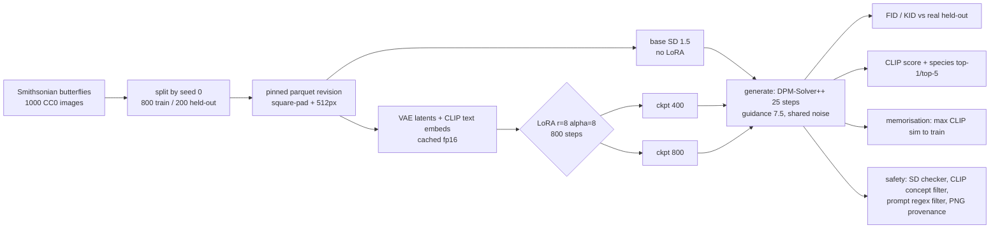

# Diffusion LoRA on museum specimens: KID, memorisation, safety


Fine-tune Stable Diffusion 1.5 with LoRA on 1,000 CC0 museum specimen photos of butterflies, then answer the questions a diffusion project is usually allowed to skip: **did the fine-tune actually improve anything measurable, did it memorise the training images, and does the safety filter work?**

> **Status:** code, configs, tests and CI are complete (17 tests, ruff clean). The full run (`configs/main.yaml`) has **not finished yet**, so there is no results table here. Every number will be copied from `reports/` after the run; none is estimated.

## Problem and success criteria

| | |
|---|---|
| Task | Text-to-image fine-tuning of SD 1.5 with LoRA (rank 8), conditioned on species captions |
| Primary metric | **KID ×1000** against held-out real images (unbiased at small *n*), with **FID** reported next to it |
| Secondary | CLIP score, species retrieval top-1/top-5, memorisation (max CLIP similarity to train), clip-flag rate, ms/image |
| Baseline to beat | the same pipeline **without** LoRA (`base`), and the **real-vs-real floor** (held-out real images vs real training images) |
| Ablation | LoRA at **400 vs 800 steps** (2 checkpoints, evaluated separately) |
| Seed protocol | training seed = generation seed, 3 seeds, identical noise per prompt across variants |
| Done when | 3 seeds per variant with bootstrap CIs, the real-vs-real floor computed, memorisation measured rather than assumed, and a layered safety report |

Why KID first: with 200 held-out images FID is biased upward and cannot be compared with published numbers. KID is unbiased at that *n*, and the real-vs-real floor gives the scale to compare against.

## Data

[`huggan/smithsonian_butterflies_subset`](https://huggingface.co/datasets/huggan/smithsonian_butterflies_subset) — 1,000 specimen photos (one per species, background removed) drawn from the Smithsonian Open Access collection. **License: CC0-1.0** (public domain). The dataset **revision is pinned** in `src/sdlora/data.py` (`3cdedf8…`), so the images cannot change under you.

- Downloaded once with `huggingface_hub.hf_hub_download` (parquet, then decoded), not via `datasets`.
- Each image is square-padded with the median border colour (keeps the full wingspan) and resized to 512.
- **Split:** `n_test=200` species are held out by `split_seed=0`. They serve as (a) the FID/KID reference set and (b) the generation prompts. The remaining 800 train the LoRA. The mask is deterministic, so every variant and seed sees the identical held-out species.

## Approach



Design choices, one recommendation each:

- **LoRA on the UNet only, frozen VAE and text encoder** — 1,000 images cannot justify training the text encoder, and caching VAE latents plus caption embeddings is what makes 800 steps fit a free T4.
- **Train 800 steps in fp16 with gradient checkpointing and grad-norm clipping** — LoRA weights stay fp32 under autocast, which is stable at lr 1e-4 where full-fp16 LoRA diverges.
- **Shared noise across variants** — every variant sees the same starting latents per prompt, so the comparison is paired rather than two independent samples.
- **KID + a real-vs-real floor instead of chasing published FID** — with 200 images, absolute FID is meaningless; relative movement against the floor is not.
- **Measure memorisation, do not assume it** — CLIP cosine to the nearest training image, reported as both the max and the share above 0.95.

## Repository layout

```
09-domain-lora/
├── configs/            main.yaml (full), smoke.yaml (48 images, 20 steps, plumbing only)
├── src/sdlora/         config data gpu metrics safety report experiment utils
├── scripts/            run_experiment.py  generate.py  make_notebook.py
├── tests/              test_config test_data test_metrics test_report test_safety (no GPU, no downloads)
├── notebooks/          kaggle_run.ipynb  (thin wrapper: clone -> install -> smoke -> full)
├── pyproject.toml  requirements.txt  requirements-gpu.txt  requirements-dev.txt  requirements-ci.txt
└── README.md
```

`src/sdlora/gpu.py` is the only module that imports torch/diffusers/peft/transformers, and only when a function is called — the 17 tests run on CPU with no model weights.

## Setup and run

```powershell
cd "D:\Projects\Artificial Intelligence\09-domain-lora"
python -m venv .venv; .\.venv\Scripts\Activate.ps1
pip install -r requirements-dev.txt -r requirements.txt
pip install -e . --no-deps

pytest -q            # 17 tests, CPU only
ruff check .
```

Full run (Kaggle T4, resumable — finished `(variant, seed)` pairs are skipped on re-run):

```powershell
pip install -r requirements-gpu.txt
python scripts\run_experiment.py --config configs\main.yaml --check
```

`--check` asserts that every run finished and that the LoRA actually changes the images; without it a silent no-op fine-tune would still produce a results table.

Fast plumbing check (48 images, 16 prompts, 20 steps — numbers are meaningless by design):

```powershell
python scripts\run_experiment.py --config configs\smoke.yaml --check
```

Generate from a trained adapter:

```powershell
python scripts\generate.py "a museum specimen photo of a Morpho butterfly, Nymphalidae family" --adapter outputs\main\lora\s0
```

`torch`/`torchvision` are **not** pinned: the CUDA build comes from the Kaggle/Colab image. Freeze what you actually got with `pip freeze > requirements-lock.txt` after a successful run.

## Results

**Not run yet.** A completed run writes, under `outputs/main/`:

| file | contents |
|---|---|
| `results.md` | mean ± std over seeds for base and both LoRA checkpoints: FID, KID×1000, CLIP score, top-1/top-5, memorisation, clip-flag rate, ms/image — plus the real-vs-real floor row |
| `bootstrap.md` | paired bootstrap of each variant against `base` |
| `safety.md` | prompt-filter categories, image-filter false-positive rates on benign prompts, provenance description |
| `training.md` | the LoRA training log (loss, lr, steps, seconds) |
| `gen/`, `grids/` | every generated PNG with provenance metadata, plus 8-image contact sheets |
| `lora/` | the adapter weights and `train.json` per seed |

## Metrics, defined

- **FID / KID** — against the 200 held-out real images. FID is biased at this *n*, so it is reported beside KID and beside the floor.
- **CLIP score** — `100 × cos(image, caption)` with CLIP ViT-B/16.
- **top-1 / top-5** — the generated image is embedded and must retrieve its own species name among all 200 held-out species; chance is 1/200 and 5/200.
- **mem_max_sim** — mean over images of the maximum CLIP cosine to any training image; **mem_frac_ge_095** — the share of images with a near-copy (≥ 0.95). A memorising model spikes both.
- **clip_flag_rate** — share of benign generations the concept filter flags (a false-positive rate, not a safety score).

## Safety

Three layers, each measured in `safety.md`:

1. **Prompt filter** — regex categories run on the raw *and* de-obfuscated prompt (leetspeak, spacing, homoglyph folding).
2. **Image filter** — CLIP similarity against unsafe vs safe concept prompts, thresholded; plus SD's bundled safety checker, which blacks out flagged images.
3. **Provenance** — every saved PNG carries `ai_generated=true`, base model, LoRA id and prompt in its metadata.

The filter is a **mitigation, not a guarantee**: CLIP-based concept filtering has known gaps, which is exactly why the false-positive rate on benign prompts is reported.

## Limitations

- 1,000 images, one per species — this is a style/domain adapter, not a species-accurate generator.
- 200 held-out images make every metric noisy; the bootstrap CIs show how noisy.
- 800 LoRA steps is deliberately short (free-T4 budget); a longer run may improve fidelity and may also memorise more.
- Memorisation measured by CLIP cosine is a proxy: a true nearest-neighbour pixel check is stronger.
- Base model licence: **CreativeML OpenRAIL-M** — its use restrictions pass through to any adapter you publish. Dataset is CC0, so the images themselves are unencumbered.

## Future work

- Compare rank 4/8/16 at a fixed step budget, with the same paired noise.
- Add a pixel-space nearest-neighbour memorisation check next to the CLIP proxy.
- Evaluate a text-encoder LoRA once the image fidelity is established.
