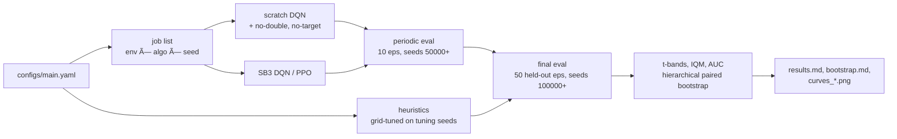

# RL for inventory control: DQN from scratch vs SB3 DQN/PPO vs tuned (s, S) heuristics


A custom Gymnasium environment models a single-item shop with a 2-day lead time, a fixed ordering cost, lost sales, and a weekday demand cycle. The project compares a from-scratch PyTorch DQN (plus two ablations), Stable-Baselines3 DQN and PPO, and four classical heuristics. The heuristics are tuned on separate seeds. Every learner runs 5 training seeds and is scored on the same 50 held-out episodes. Results get Student-t intervals across seeds and a hierarchical paired bootstrap. CartPole-v1 runs through the same code as a sanity check.

**Headline (Kaggle CPU, 4 vCPU, 5 training seeds, 50 held-out episodes; profit per 91-day episode):**
- **No RL agent beats the informed heuristic.**
  - The tuned weekday (s, S) heuristic earns **2,331**.
  - SB3 PPO earns **2,326 ± 5**, a statistical tie: −4.9, 95% CI [−16.4, +7.0].
  - PPO does significantly beat the plain (s, S) policy, +64 [+48, +80]. Plain (s, S) is the textbook optimum for i.i.d. demand, and it can't see the weekday.
- **The from-scratch DQN learns a real policy**, 2,209 ± 103, which is +441 over base-stock. It still trails the weekday heuristic by 122 [57, 214].
  - The error analysis finds the cause. The DQN places 35 orders per episode against the heuristic's 25.5, which costs about 96 in extra fixed fees and 27 in extra holding. Its lost sales are actually lower.
- **The target network is the component that matters.** Without it, DQN collapses on both environments: −2,346 profit on inventory, and 9.4 vs 163 on CartPole.
  - Double-DQN made no measurable difference. DQN minus DQN-without-double is −35 [−139, +55] on inventory and −113 [−294, +52] on CartPole.

## Problem and success criteria

| | |
|---|---|
| Task | choose a daily order quantity (9 discrete sizes, 0–40) to maximise profit over a 13-week horizon |
| Primary metric | mean episode profit over the 50 held-out episodes (seeds 100000–100049), then mean ± std over 5 training seeds, with a t 95% CI |
| Also reported | IQM, area under the learning curve (sample efficiency), fill rate, wall-clock training time. On CartPole: solved seeds (eval ≥ 475) and median steps to solve |
| Baselines | `random`, `base_stock(S)`, `sS(s, S)`, `dow_sS(q, batch)` (weekday-aware, knows the true demand model). Each is grid-tuned on 30 separate tuning episodes (seeds 200000+) |
| Comparisons | hierarchical paired bootstrap, 5,000 resamples: training seeds are resampled per side, and evaluation episodes are shared |

Fill rate is reported but is **not** the objective. Random ordering reaches a 0.992 fill rate while losing money.

## Environment: `Inventory-v0` (custom, synthetic)

| | |
|---|---|
| Dynamics | the order from 2 days ago arrives (anything above capacity 60 is discarded but still paid for) → Poisson demand, base 10 × weekday multiplier (0.7 Mon … 1.6 Sat) → unmet demand is lost → the agent orders → holding cost |
| Economics | price 5, unit cost 2, fixed order cost 10, holding 0.1/unit/day, stockout penalty 3/unit |
| Observation | 6 floats: on-hand / capacity, the 2 pipeline slots, sin/cos of the weekday, and the horizon fraction |
| Reward | daily profit × 0.01 (keeps Q-targets O(1)). Every reported number is unscaled profit |
| Licence / privacy | everything is simulated, with no data download. CartPole-v1 comes from Gymnasium (MIT) |

## Approach



* **Scratch DQN** (`rlinv.dqn`): replay buffer, target network, Double-DQN targets, Huber loss, linear ε decay, 128×128 MLP, lr 5e-4. Ablations:
  - `dqn_nodouble`: the vanilla max target.
  - `dqn_notarget`: the target network is synced every step.
* **SB3:** on CartPole, DQN and PPO use hyperparameters adapted from rl-baselines3-zoo. On inventory, SB3 DQN mirrors the scratch DQN's settings (lr 5e-4, 128×128, target update 1000, ε over 30%), so the two DQNs are a like-for-like implementation check. PPO uses near-default settings: 8 envs × 256 steps, lr 3e-4, ent 0.01. No learner was tuned on inventory, which is noted under limitations.
* **Separate seed pools:**
  - Learning-curve evals use seeds 50000+.
  - The final held-out eval uses 100000+.
  - Heuristic tuning uses 200000+.
  No checkpoint selection happens on the held-out seeds; the last checkpoint is the one scored.
* **Budgets:** 150k env steps on inventory and 50k on CartPole, per seed.

## Repo structure

```
10-rl-inventory/
├── configs/            smoke.yaml (tiny, CI-speed), main.yaml (the reported run)
├── notebooks/          kaggle_run.ipynb (generated by scripts/make_notebook.py; only calls the package)
├── reports/kaggle_cpu/ results.md, bootstrap.md, results.json, runs.json, curves_*.png, error_analysis.md, env/versions
├── scripts/            run_experiment.py, play.py (day-by-day demo), error_analysis.py, make_notebook.py
├── src/rlinv/          envs, heuristics, dqn, agents (SB3 wrappers), evaluate, stats, report, experiment, config
└── tests/              env dynamics, heuristics, DQN learning, config/agents, stats/report (22 tests)
```

## Reproduce

```bash
cd 10-rl-inventory
python -m pip install -r requirements.txt && python -m pip install -e . --no-deps
python scripts/run_experiment.py --config configs/smoke.yaml --check                 # ~1 min sanity run
python scripts/run_experiment.py --config configs/main.yaml --check --set output_dir=outputs/main   # the reported run
python scripts/play.py --run-dir outputs/main --days 14 --seed 100000                 # DQN vs weekday (s,S), day by day
python scripts/error_analysis.py outputs/main reports/kaggle_cpu                      # cost breakdown + curve stability
pytest -q && ruff check .
```

The reported run came from `notebooks/kaggle_run.ipynb` on a Kaggle CPU session: AMD EPYC 7B12, 4 vCPU, torch 2.11.0+cpu, gymnasium 1.3.0, SB3 2.9.0. Exact versions are in `reports/kaggle_cpu/versions.txt`. Trained weights (`*.pt`) are not committed, so rerun the main config to get them.

## Results (`reports/kaggle_cpu/results.md`)

**Inventory-v0**, profit per episode:

| method | seeds | final mean ± std | 95% CI | IQM | AUC | fill rate | train s / seed |
|---|---|---|---|---|---|---|---|
| random | 1 | −47.7 | n/a | −43.3 | n/a | 0.992 | n/a |
| base_stock (S=50) | 1 | 1,768.0 | n/a | 1,772.1 | n/a | 0.990 | n/a |
| sS (s=38, S=70) | 1 | 2,262.0 | n/a | 2,273.1 | n/a | 0.979 | n/a |
| **dow_sS (q=0.8, batch=35)** | 1 | **2,331.1** | n/a | 2,331.8 | n/a | 0.989 | n/a |
| dqn (scratch) | 5 | 2,209.1 ± 102.6 | [2,081.6, 2,336.5] | 2,223.3 | 2,060.7 | 0.990 | 414 |
| dqn_nodouble | 5 | 2,244.4 ± 71.0 | [2,156.2, 2,332.6] | 2,247.3 | 2,074.6 | 0.990 | 414 |
| dqn_notarget | 5 | −2,346.1 ± 814.7 | [−3,357.7, −1,334.5] | −2,031.0 | −3,097.4 | 0.994 | 459 |
| sb3_dqn | 5 | 2,229.6 ± 47.3 | [2,170.9, 2,288.3] | 2,237.1 | 2,064.6 | 0.991 | 533 |
| **sb3_ppo** | 5 | **2,326.2 ± 5.2** | [2,319.6, 2,332.7] | 2,333.7 | 1,823.8 | 0.989 | 83 |

The heuristics are deterministic given the evaluation seeds, so they have one "seed".

**Paired differences** (hierarchical bootstrap, `bootstrap.md`):

| a − b | diff | 95% CI |
|---|---|---|
| sb3_ppo − dow_sS | −4.9 | [−16.4, +7.0] |
| sb3_ppo − sS | +64.2 | [+47.8, +80.2] |
| sb3_ppo − dqn | +117.1 | [+51.9, +208.2] |
| dqn − dow_sS | −122.0 | [−213.9, −57.0] |
| dqn − base_stock | +441.0 | [+349.6, +505.3] |
| dqn − sb3_dqn | −20.5 | [−114.8, +57.6] |
| dqn − dqn_nodouble | −35.3 | [−139.3, +54.6] |
| dqn − dqn_notarget | +4,555.2 | [+4,132.0, +5,306.8] |

**CartPole-v1** (sanity check, 50k steps):

| method | final mean ± std | solved seeds | median steps to solve | train s |
|---|---|---|---|---|
| dqn (scratch) | 163.3 ± 93.2 | 1/5 | 35,000 | 133 |
| dqn_nodouble | 276.3 ± 204.6 | 3/5 | 47,500 | 135 |
| dqn_notarget | 9.4 ± 0.1 | 0/5 | n/a | 140 |
| sb3_dqn | 342.7 ± 224.1 | 5/5 | 35,000 | 130 |
| sb3_ppo | 500.0 ± 0.0 | 5/5 | 15,000 | 62 |

Learning curves with t-bands: `reports/kaggle_cpu/curves_Inventory-v0.png`, `curves_CartPole-v1.png`.

## Error analysis (`reports/kaggle_cpu/error_analysis.md`)

**Where the DQN loses 126 profit/episode against the weekday heuristic** (seed-0 DQN, 50 held-out episodes):

| policy | profit | orders | units ordered | fixed cost | lost sales | wasted | holding | stock left at horizon |
|---|---|---|---|---|---|---|---|---|
| dqn_seed0 | 2,204.7 | 35.1 | 1,000.9 | 350.8 | 8.9 | 2.0 | 241.1 | 51.0 |
| dow_sS | 2,331.1 | 25.5 | 993.2 | 254.8 | 10.5 | 2.4 | 213.8 | 44.4 |

* **The gap is about batching, not service.** Both policies buy about the same total (1,001 vs 993 units). But the DQN splits it into 9.6 more orders, at 10 each (+96), and carries more stock (+27 holding). It actually loses *fewer* sales.
  - Learning "order less often, in bigger lots" requires credit assignment across a fixed cost paid today for sales over the next 3–5 days. With γ = 0.99 and ε-greedy exploration, that is the hard part.
* **Both policies end the horizon holding stock** (51 vs 44 units, about 90–100 of purchase cost thrown away). The observation includes the horizon fraction, but neither policy runs stock down before the end. The heuristic doesn't know the horizon exists.
* **Last-checkpoint instability** (eval curves, 10 episodes every 7.5k steps):

  | algo | mean final eval | mean peak eval | peak − final | seeds ending < 95% of peak |
  |---|---|---|---|---|
  | dqn | 2,237.9 | 2,327.6 | 89.7 | 1/5 |
  | dqn_nodouble | 2,274.8 | 2,351.8 | 77.0 | 2/5 |
  | sb3_dqn | 2,214.6 | 2,342.3 | 127.7 | 2/5 |
  | sb3_ppo | 2,345.9 | 2,364.1 | 18.1 | 0/5 |

  Value-based agents pass through policies as good as the heuristic and then drift away. Seed 0's curve, for example, peaks at 2,330 at 97.5k steps and dips to 1,845 at 120k. PPO's clipped on-policy updates are far more stable here: std 5 vs 103 across seeds.
  - Picking the best checkpoint on the *curve* seeds (not the held-out ones) would probably close part of the gap. It was left out so the comparison stays "fixed budget, last checkpoint" for every learner.
* **No target network = divergence.** `dqn_notarget` has the highest fill rate (0.994) and the worst profit. It over-orders until capacity waste and holding swamp revenue. This is the bootstrapping instability the target network exists to damp.
* **CartPole caveat:** the scratch DQN solves only 1 of 5 seeds within 50k steps, and the vanilla-target variant does slightly better (3/5), within noise. SB3 DQN, using rl-zoo hyperparameters (large batch of gradient steps every 256 env steps), solves all 5 but is unstable afterwards: final 343 ± 224.
  - This says the scratch DQN's hyperparameters are untuned for CartPole. It doesn't say the implementation is wrong. The unit tests check that it learns a one-step bandit, that the Double-DQN and vanilla targets match hand computations, and the replay buffer and ε schedule. On inventory, the scratch and SB3 DQN, with matched settings, are statistically indistinguishable: −20.5 [−114.8, +57.6].

## Limitations and ethics

* The environment is a stylised single-SKU model with a known stationary demand process. Real retail adds substitution, promotions, perishability, non-stationarity and censored demand (you only observe sales). The informed heuristic exploits the known demand model, which a real planner wouldn't have exactly.
* RL hyperparameters were not tuned per environment, while the heuristics were grid-tuned. That favours the heuristics, and it's stated rather than hidden. A fair next step is an equal-budget tuning sweep on the tuning seeds.
* Five seeds give wide intervals for the unstable learners: the DQN CI spans 255 profit units.
* No personal data is involved. In a real deployment, an automated ordering policy should run in shadow mode next to the existing one, with order-size caps and human override, before it places real orders.

## Demo, career assets, interview prep

See [docs/DEMO_SCRIPT.md](docs/DEMO_SCRIPT.md), [docs/CAREER.md](docs/CAREER.md) and [docs/INTERVIEW.md](docs/INTERVIEW.md).
