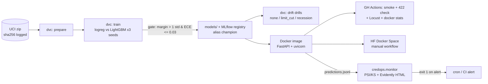

# Credit-risk MLOps: FastAPI · Docker · MLflow · DVC · Evidently

This project takes the P1 credit-default model to production shape: a reproducible DVC pipeline, MLflow tracking and a model registry, a promotion gate, a typed FastAPI service with Prometheus metrics and a prediction log, a Docker image, CI that trains, builds, smoke-tests and load-tests that image, a manual free deploy to a Hugging Face Docker Space, drift drills and a drift monitor, and a cost estimate based on measured throughput.

> **Not for real lending decisions.** The model was trained on 2005 Taiwanese card data. It exists to demonstrate the engineering. See [Ethics](#ethics-and-limitations).

## A. Problem and metrics
- **Task:** estimate P(default next month) for a card client from their last 6 months of limit, repayment status, bills and payments. The score routes clients to a *human-reviewed* referral queue.
- **Primary metric:** PR-AUC, because the positive class is 22% and the queue cares about ranking the positives.
- **Calibration:** ECE and Brier. The probability is shown to a reviewer, so it must mean what it says.
- **Operating point:** F1 at an out-of-fold threshold chosen on training data only.
- **Service SLOs:** p95 latency and throughput under Locust; the image's CPU and memory from `docker stats`.

## B. Data, license, split
- **Source:** UCI *Default of Credit Card Clients* (Yeh 2009, id 350), **CC BY 4.0**. It is downloaded by `prepare` and never committed. Its SHA-256 is logged in `data/processed/data_card.json` (`30c6be3a…0933`).
- **Size:** 30,000 rows; positive rate 0.2212. A stratified 80/20 split with `split_seed: 42` gives 24,000 train and 6,000 test rows, the same cleaning as P1.
- **Inputs:** 19 model inputs (`LIMIT_BAL`, `PAY_1..6`, `BILL_AMT1..6`, `PAY_AMT1..6`). `SEX`, `EDUCATION`, `MARRIAGE` and `AGE` are **dropped**. The API schema doesn't contain them either, so they are never received or logged.

## C. Approach
- **Baseline:** standardised logistic regression.
- **Candidate:** LightGBM wrapped in 5-fold isotonic calibration.
- **Shared steps:** both use the same row-wise `CreditFeatures` transformer (utilisation, payment ratios, delinquency counts), and both are trained on 3 seeds.
- **Promotion gate (`params.yaml: gate`):** the candidate becomes champion only if **both** of these hold:
  - its PR-AUC margin is larger than 1 × its seed std;
  - its ECE is at most 0.03.
- **Export:** the champion (seed 0) goes to `models/` as joblib plus metadata, and is logged to MLflow. In MLflow it is registered as `credit-default`, with the alias `champion`.



## D. Repo structure
```
11-credit-risk-mlops/
  params.yaml  dvc.yaml  Dockerfile  docker-compose.yml  pyproject.toml
  requirements.txt (train)  requirements-serve.txt (image)  requirements-ci.txt  requirements-dev.txt
  src/credops/  data.py features.py model.py pipeline.py schema.py api.py drift.py simulate.py monitor.py synthetic.py
  loadtest/locustfile.py
  tests/  test_core.py test_pipeline_api.py (synthetic data, no download)
  reports/  results.md metrics.json train_runs.csv drift.md drift.json locust/  cost.md
  docs/  DEMO_SCRIPT.md CAREER.md INTERVIEW.md
  .github/workflows/p11-ci.yml  p11-deploy.yml   (at the monorepo root)
```

## E. Run it
```bash
python -m venv .venv && .venv/Scripts/pip install -r requirements.txt -r requirements-dev.txt && .venv/Scripts/pip install --no-deps -e .
dvc repro                                    # prepare -> train -> drift (or: python -m credops.pipeline prepare|train|drift)
mlflow ui --backend-store-uri sqlite:///mlflow.db
uvicorn credops.api:app --port 8000          # MODEL_DIR=models, PREDICTION_LOG=logs/predictions.jsonl
docker build -t credops . && docker run -p 8000:8000 credops
locust -f loadtest/locustfile.py --host http://127.0.0.1:8000 --headless -u 50 -r 10 -t 60s --csv reports/locust/run
python -m credops.monitor --log logs/predictions.jsonl --html reports/monitor.html   # exit 1 on drift alert
pytest -q && ruff check .
```

- **Pinned versions:** scikit-learn 1.9.0, LightGBM 4.6.0, FastAPI 0.139.1, MLflow 3.14.0, DVC 3.67.1, Evidently 0.7.23.
- **The image installs only `requirements-serve.txt`.** Those versions must match the training environment, because the model is a pickle.

**API:**

| endpoint | what it does |
|---|---|
| `/health` | liveness |
| `/ready` | readiness |
| `/model-info` | model metadata |
| `/predict` | one row |
| `/predict/batch` | 1–1,000 rows |
| `/metrics` | Prometheus metrics |

- Out-of-range values return 422, and so do unknown fields.

## F. Results (3 seeds, 6,000-row held-out test set, local CPU)

| model | PR-AUC | ROC-AUC | Brier | ECE | F1 | threshold | fit s |
|---|---|---|---|---|---|---|---|
| logreg (baseline) | 0.4977 ± 0.0000 | 0.7387 ± 0.0000 | 0.1435 ± 0.0000 | 0.0147 ± 0.0000 | 0.5115 ± 0.0027 | 0.270 ± 0.014 | 1.4 ± 0.2 |
| **LightGBM + isotonic** | **0.5551 ± 0.0025** | **0.7750 ± 0.0003** | **0.1355 ± 0.0001** | **0.0089 ± 0.0025** | **0.5399 ± 0.0004** | 0.278 ± 0.008 | 35.9 ± 4.3 |

- **Gate:** margin 0.0574 > 1 × 0.0025 and ECE 0.0089 ≤ 0.03, so the candidate was promoted.
- **Served model:** `lgbm-25ce825-202611221646` (seed 0) at threshold 0.2837. Its test PR-AUC is 0.5554 and its ECE 0.0072.
- **Registry:** it is credit-default **v1**, with alias `champion`. `mlflow.sklearn.load_model("models:/credit-default@champion")` reloads it.
- **Why the logreg std is 0:** lbfgs is deterministic, so the seed changes only the out-of-fold threshold.

### Load test and cost
LOADTEST_PENDING

## G. Error analysis: drift drills
`dvc repro` runs three synthetic "production" scenarios on the held-out set. They are illustrative stress tests, not forecasts.
- **Per-column drift test:** PSI > 0.25 **and** KS p < 0.01.
- **Dataset alert:** more than 20% of the columns drifted.

| scenario | alert | drifted cols | top PSI column | score PSI | default rate | mean P | PR-AUC | ECE |
|---|---|---|---|---|---|---|---|---|
| none (bootstrap) | no | 0/19 | BILL_AMT4 (0.006) | 0.001 | 0.228 | 0.223 | 0.5647 | 0.0125 |
| limit_cut (−30% limits) | no | 1/19 | LIMIT_BAL (0.518) | 0.043 | 0.228 | 0.231 | 0.5569 | 0.0160 |
| recession (+1 month late for 30%, bills +25%, +17 pt defaults) | no | 0/19 | PAY_1 (0.103) | 0.127 | 0.403 | 0.263 | 0.5772 | **0.1420** |

**The input-drift monitor does not catch the scenario that matters.**
- **limit_cut:** a 30% limit cut is a large covariate shift (PSI 0.52 on one column), but the model barely cares. PR-AUC moves 0.008 and ECE 0.004. A column-level alert here would be a correct but low-priority page.
- **recession:** the inputs barely move (top PSI 0.10, nothing drifted) while the true default rate nearly doubles. Ranking survives (PR-AUC 0.577), but **calibration collapses**: the model says 0.263 on average against an actual 0.403, and ECE is 0.142. That is concept shift. Only the *score* PSI moves at all (0.127, the "moderate" band).
- **What a real deployment would need:**
  - an alert on score PSI over 0.1;
  - label-delayed performance monitoring: defaults are known one month later, so track ECE on matured cohorts;
  - a recalibration path.

I did **not** retune the thresholds to make the drills light up. The negative result is the finding.

## H. Tests and CI
**Tests:** 11 pytest tests on synthetic data, so no download is needed.
- the features are row-wise and never use the protected columns
- ECE, the threshold, PSI and the drift rule
- the scenarios
- the train stage exports and reports
- the drift stage
- every API endpoint, including 422 on invalid input and the batch limits
- the monitor on logged traffic
- MLflow registration of the LightGBM champion, including the skops trusted types

**`p11-ci.yml`, job 1:** ruff + pytest.

**`p11-ci.yml`, job 2:**
1. Train a 1-seed model.
2. Build the Docker image.
3. curl the health, predict and 422 endpoints.
4. Run Locust for 30 s with 20 users and record `docker stats`.
5. Upload the reports.

**`p11-deploy.yml`** (manual): retrains with `params.yaml` and pushes a Docker Space. It needs a `HF_TOKEN` secret and a `HF_SPACE` variable, which the repo owner has to create.

## I–M
See [docs/DEMO_SCRIPT.md](docs/DEMO_SCRIPT.md), [docs/CAREER.md](docs/CAREER.md) and [docs/INTERVIEW.md](docs/INTERVIEW.md).

## Ethics and limitations
- **Fair lending:**
  - The protected attributes (sex, education, marital status, age) are excluded from both the inputs and the API.
  - Proxies remain possible: limit and bill amounts can correlate with them. A real lender would need a disparate-impact audit on held-out protected labels, and adverse-action reason codes.
- **Human in the loop:** the score *flags* clients for review. It never declines automatically.
- **Privacy:** the prediction log stores model inputs. In production, pseudonymise IDs, set a retention limit, and restrict access.
- **Data:** the data is 2005 Taiwan, CC BY 4.0, with attribution to Yeh (2009). The distribution shift to any current population is unknown, which is exactly why the drift section matters.
- **Pickle risk:** joblib/pickle loads only artefacts you built. MLflow uses skops with an explicit list of trusted types.
