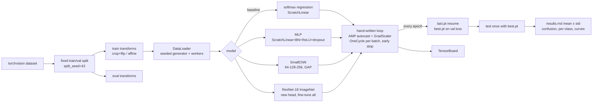

# Deep-learning fundamentals: from-scratch MLP/CNN vs a pretrained ResNet-18


The goal is to show the training machinery that frameworks hide. Fully connected layers are written by hand (`x @ W.T + b`, He init), and the training loop is written by hand too: no `Trainer` or Lightning. Around them: augmentation, a per-batch LR schedule, mixed precision, early stopping, checkpoint/resume and TensorBoard. Everything runs on MNIST, then CIFAR-10, and is compared against a pretrained ResNet-18 fine-tune.

## Problem and success criteria

| | |
|---|---|
| Task | 10-class image classification |
| Metrics | test **accuracy** (primary), macro-F1, test cross-entropy, loss/accuracy curves, confusion matrix |
| Efficiency | parameters (M), training images/s, wall-clock minutes |
| Baseline | softmax regression (`linear`): one hand-written linear layer on raw pixels |
| Protocol | mean ± std over 3 seeds; one fixed train/val split; the official test set is used once, for the best-val-loss weights |

## Data

| | MNIST | CIFAR-10 |
|---|---|---|
| Source | `torchvision.datasets.MNIST` | `torchvision.datasets.CIFAR10` |
| Size | 60k train / 10k test, 28×28 grey | 50k train / 10k test, 32×32 RGB |
| Split | 55k train / 5k val (split_seed 42), official test | 45k train / 5k val (split_seed 42), official test |
| Licence | Commonly redistributed under CC BY-SA 3.0 (Y. LeCun & C. Cortes) | No formal licence; published by A. Krizhevsky for research use. Cite Krizhevsky (2009) |

The ResNet-18 weights (`ResNet18_Weights.IMAGENET1K_V1`, BSD-3 code) were trained on ImageNet, whose images have their own non-commercial terms. That is fine for this educational project, but check before any commercial use. Neither dataset contains personal data. CIFAR-10 images are tiny internet photos scraped in 2008.

`python scripts/download_data.py` prints n, shape and per-class min/max for every split, so the numbers above can be checked.

## Approach



| Model | What it shows | Params (CIFAR-10) |
|---|---|---|
| `linear` (baseline) | how far raw pixels get you | 0.03M |
| `mlp` (512-256) | depth without spatial structure; BN and dropout | ~1.7M |
| `cnn` (VGG-style, 3 stages + global average pool) | convolution's inductive bias at a similar parameter count | ~1.15M |
| `resnet18` (pretrained) | transfer learning. Input is upsampled to 128 px with ImageNet normalisation | ~11.2M |

Trade-offs, one recommendation each:

- **SGD + Nesterov with OneCycle**, not Adam. It reaches better test accuracy on small CNNs in a fixed epoch budget, and the schedule is stepped per batch.
- **Early stopping on val loss**, not val accuracy. Loss is smoother and catches over-confidence earlier.
- **No weight decay on biases or BN parameters.** Decaying them hurts BN's scale and gives no regularisation benefit.
- **fp16 autocast + GradScaler** (`torch.amp`; `torch.cuda.amp` is deprecated since torch 2.4). It roughly doubles throughput on an RTX 3050 with no accuracy loss. The `no_amp` ablation measures this.
- **ResNet-18 at 128 px, not 224.** It fits in 4 GB of VRAM with batch 128 and is about 3× faster; most of the transfer benefit is kept.

Recent API changes this code follows: `weights=` replaces the removed `pretrained=` in torchvision; `torch.amp.GradScaler("cuda")` replaces `torch.cuda.amp.GradScaler`; `torch.load(..., weights_only=True)` is the default since torch 2.6. `best.pt` (weights only) loads that way; `last.pt` also holds optimiser and RNG state, so it is loaded with `weights_only=False`. Only ever load a `last.pt` you created yourself.

## Repository structure

```
p2-dl-fundamentals/
├── configs/            cifar10.yaml, mnist.yaml, smoke.yaml, ablations.md
├── src/dlfund/
│   ├── config.py       dataclass configs + --set overrides + validation
│   ├── data.py         datasets, transforms, fixed split, seeded loaders
│   ├── models.py       ScratchLinear, MLP, SmallCNN, ResNet-18 head swap
│   ├── train.py        training loop, AMP, schedules, early stopping, checkpoints
│   ├── evaluate.py     metrics, per-class, confusions, mean ± std tables
│   ├── plots.py        learning curves, confusion matrices
│   ├── experiment.py   seeds × models runner (resumable)
│   └── utils.py        seeding, device, logging
├── scripts/            run_experiment.py, download_data.py, compare_ablations.py
├── tests/              35 tests on CPU with FakeData (no download)
├── notebooks/          kaggle_run.ipynb (thin wrapper)
├── reports/            committed snapshot of the final runs
└── docs/               INTERVIEW.md, DEMO_SCRIPT.md, CAREER.md
```

## Setup and usage

```bash
python -m venv .venv && .venv\Scripts\activate          # or source .venv/bin/activate
pip install torch==2.11.0 torchvision==0.26.0 --index-url https://download.pytorch.org/whl/cu128
pip install -r requirements.txt -r requirements-dev.txt && pip install -e . --no-deps
python scripts/download_data.py                                     # MNIST 11 MB, CIFAR-10 170 MB
python scripts/run_experiment.py --config configs/smoke.yaml        # 2-minute sanity check, not reportable
python scripts/run_experiment.py --config configs/mnist.yaml        # 3 seeds × 3 models
python scripts/run_experiment.py --config configs/cifar10.yaml      # 3 seeds × 4 models
tensorboard --logdir outputs/cifar10/tb
pytest && ruff check .
```

Local notes (Windows laptop, RTX 3050 4 GB):

- **Reuse an existing CUDA torch** instead of downloading 2.5 GB again: `uv venv --python 3.13 --system-site-packages .venv`, then `uv pip install --python .venv/Scripts/python.exe -e . --no-deps`.
- **Offline MNIST:** if a Keras copy exists at `~/.keras/datasets/mnist.npz`, `python scripts/mnist_from_npz.py` writes torchvision's raw idx files to `data/MNIST/raw`. The per-class counts match the official set.
- **DataLoader workers on Windows** are spawned processes, and each one reloads torch's CUDA DLLs, which commits several hundred MB per worker. When other jobs already hold most of the commit limit, workers die with `WinError 1455 (paging file too small)`. Use `--set data.num_workers=0`. On Windows, val/test loaders always run in-process.
- CIFAR-10 (170 MB) and the ImageNet ResNet-18 weights were too slow to download on this connection, so the CIFAR-10 runs go to Kaggle (`notebooks/kaggle_run.ipynb`).

Any config value can be overridden: `--set train.epochs=5 "models=[cnn]"`. Runs are **resumable**: finished (seed, model) pairs are skipped, and an interrupted model continues from `checkpoints/<run>/last.pt` (model, optimiser, scheduler, scaler, early-stopping and RNG state). On Kaggle, `notebooks/kaggle_run.ipynb` (GPU T4, Internet on, *Save & Run All*) runs MNIST, CIFAR-10 and the three ablations, then zips metrics, per-class tables and figures into `p2_results.zip`. Unzip it into `outputs/`, then copy into `reports/`.

Reproducibility: `set_seed` seeds Python, NumPy and torch, and DataLoader workers are seeded through a generator. GPU runs use `cudnn.benchmark=True` for speed, so repeat runs agree to within about 0.1–0.3 accuracy points, not bit-for-bit. Set `deterministic=true` for bit-exact runs (slower). The test `test_same_seed_same_result` checks exact reproducibility on CPU.

## Results

> Pending the real runs. The numbers will be copied from `outputs/{mnist,cifar10}/results.md` into `reports/`. None are filled in by hand.

| dataset | model | test acc | macro-F1 | test loss | params (M) | img/s |
|---|---|---|---|---|---|---|
| MNIST | linear (baseline) | _ | _ | _ | _ | _ |
| MNIST | mlp | _ | _ | _ | _ | _ |
| MNIST | cnn | _ | _ | _ | _ | _ |
| CIFAR-10 | linear (baseline) | _ | _ | _ | _ | _ |
| CIFAR-10 | mlp | _ | _ | _ | _ | _ |
| CIFAR-10 | cnn | _ | _ | _ | _ | _ |
| CIFAR-10 | resnet18 (pretrained) | _ | _ | _ | _ | _ |

Ablations (CNN, CIFAR-10, 3 seeds): see [configs/ablations.md](configs/ablations.md). Build the table with `python scripts/compare_ablations.py`.

## Error analysis

Per-class accuracy and the most frequent confusions for every model are written to `outputs/<run>/per_class.md`, with row-normalised confusion matrices in `figures/`. The interpretation will be written from those files after the runs.

## Limitations

- CIFAR-10 at 32 px is a well-solved benchmark. The point here is the engineering and the controlled comparison, not a state-of-the-art number.
- ResNet-18 sees upsampled 128 px inputs and ~11× more parameters, so "pretrained beats scratch" mixes two effects: pretraining and capacity. The `resnet18` from-scratch ablation (stretch goal) separates them.
- Three seeds give a rough std only. Differences smaller than about 2 std should be treated as ties.
- `cudnn.benchmark` trades bit-exact reproducibility for speed (see above).

## Ethics

Low-risk benchmark data with no people in it. CIFAR-10's scraped images have unclear copyright, so don't redistribute the raw images. The pretrained weights inherit ImageNet's known biases. That does not matter for these classes, but it would for any person-related task.
