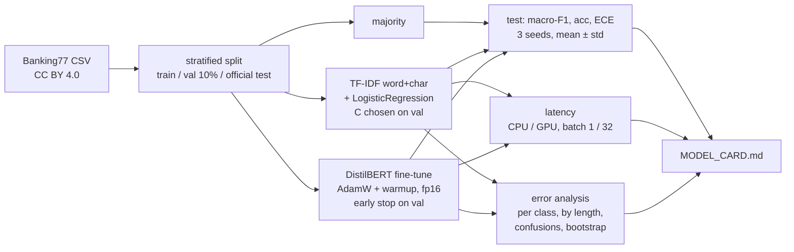

# Banking77 intent classification: TF-IDF + LR vs DistilBERT


This project routes a customer's banking message to one of 77 intents (for example `card_arrival`, `lost_or_stolen_card`, `exchange_rate`). It compares a strong classic baseline with a fine-tuned transformer on three axes: **quality** (macro-F1, accuracy, calibration), **speed** (latency on CPU and GPU) and **where each one fails** (by class, by message length, and on the examples they disagree on). The project ships a model card and a predict script that hands low-confidence messages to a human.

## Problem and success criteria

| | |
|---|---|
| Task | single-label text classification, 77 classes, short English messages |
| Primary metric | test **macro-F1**: every intent counts equally, which matches a support desk where rare intents still matter |
| Also reported | accuracy, ECE (15-bin calibration error), per-class F1, macro-F1 by length bucket, latency (ms per text at batch 1 and 32, CPU and GPU) |
| Baselines | `majority` (sanity floor) and `tfidf_lr`: word 1-2-gram + char 2-5-gram TF-IDF, then logistic regression with C picked on val |
| Main model | `distilbert`: `distilbert-base-uncased` fine-tuned end to end (max 64 tokens, early stopping on val macro-F1) |
| Protocol | 3 seeds per model, mean ± std (ddof=1). One fixed split. The test set is scored once per run. A paired bootstrap (1,000 resamples) on seed 0 gives a CI for the DistilBERT − TF-IDF macro-F1 gap. |

## Data

| | |
|---|---|
| Dataset | [Banking77](https://github.com/PolyAI-LDN/task-specific-datasets) (Casanueva et al., 2020), downloaded as CSV from the PolyAI repository on the first run |
| Licence | **CC BY 4.0**: attribution required; commercial use allowed |
| Split | The official test split is our test set. Our val set is 10% of the official train split, stratified by intent (`split_seed=42`). C selection and early stopping use val only. |
| Size (computed) | train **9,002** / val **1,001** / test **3,080** messages, 77 intents. The training data is imbalanced (32-168 per intent); the test set is balanced (40 per intent). Messages are short: mean 11 words, median 9, 95th percentile 24 on test. 7 test messages exactly match (case-insensitive) a train message. |
| Statistics | `outputs/banking77/data_summary.md` is **computed** by `textclf.data.split_stats`; none of these numbers are typed in by hand. |

Privacy: the messages are written by crowd workers for the dataset, not taken from real customers, so they carry no real personal data. A deployed version would see real customer text; see the model card for PII handling.

## Approach



Trade-offs (one recommendation each):

- **Char n-grams in the baseline:** keep them. The train split spells one concept several ways (counted: "top up" 599, "top-up" 415, "topped up" 34, "topup" 14) and has typos such as "recieve" (4 rows). Char n-grams match these variants, which makes the baseline fair rather than a straw man.
- **DistilBERT over BERT-base:** it is about 40% smaller and faster at similar quality on short texts, which matters because latency is one of the three axes.
- **max_length 64:** on test the 95th percentile is 24 words, so 64 word pieces truncates almost nothing and halves the compute of 128.
- **Macro-F1 as the headline metric:** the test set is balanced, so accuracy and micro-F1 are close; macro-F1 makes sure a weak rare intent cannot hide behind easy ones.
- **Own LambdaLR warmup instead of `transformers.get_linear_schedule_with_warmup`:** this keeps the code independent of transformers' scheduler API, which has moved between releases.

Recent API notes:

- scikit-learn 1.8+: `LogisticRegression` no longer takes `multi_class`, and `penalty` is deprecated in favour of `l1_ratio`. The code passes neither; multinomial is the default.
- PyTorch 2.x: `torch.amp.GradScaler("cuda")` and `torch.autocast(device_type="cuda")` replace the old `torch.cuda.amp.*` names.
- PyYAML reads `1e-4` (no decimal point) as a string under YAML 1.1. The config loader casts float fields, and a test covers it.

## Repository structure

```
p4-intent-classification/
├── configs/            banking77.yaml (full run), smoke.yaml (2k train rows, 1 epoch)
├── notebooks/          kaggle_run.ipynb (generated by scripts/make_notebook.py; it only calls the package)
├── scripts/            run_experiment.py, predict.py, make_notebook.py
├── src/textclf/
│   ├── config.py       dataclass configs, YAML + --set overrides, validation
│   ├── data.py         download, cleaning, stratified split, computed stats
│   ├── baselines.py    majority, TF-IDF + LR (C grid on val)
│   ├── bert.py         DistilBERT fine-tuning loop (fp16, warmup, early stopping)
│   ├── metrics.py      macro-F1, ECE, per-class, by-length, confusions, paired bootstrap
│   ├── latency.py      p50/p95 ms per batch, ms per text, texts per second
│   ├── experiment.py   resumable model x seed loop, summaries, error analysis
│   └── model_card.py   renders MODEL_CARD.md from the computed results
├── tests/              26 pytest tests (fake 3-intent data; no network, no GPU)
└── reports/            copied results from the Kaggle run
```

## Setup and usage

```bash
uv venv --python 3.13 --system-site-packages .venv
uv pip install --python .venv/Scripts/python.exe -r requirements.txt -e .
.venv/Scripts/python.exe -m pytest -q
```

Run one experiment (all models, 3 seeds):

```bash
python scripts/run_experiment.py --config configs/banking77.yaml
```

Baselines only, on a laptop CPU:

```bash
python scripts/run_experiment.py --config configs/banking77.yaml --set "models=[majority, tfidf_lr]"
```

The DistilBERT run used a Kaggle T4; `notebooks/kaggle_run.ipynb` clones this repo and runs the same command. Predict with a threshold so that unsure messages go to a human:

```bash
python scripts/predict.py --run outputs/banking77 --model tfidf_lr --threshold 0.5 "my card still hasn't come"
```

## Results

Test set (3,080 messages), mean ± std over seeds 0, 1, 2. The baselines ran on a laptop CPU (`--set "models=[majority, tfidf_lr]"`); the DistilBERT run is on a Kaggle T4 and **pending**. Raw tables: [`reports/baselines_local/`](reports/baselines_local/).

| model | macro-F1 | accuracy | ECE | seeds |
|---|---|---|---|---|
| majority | 0.000 ± 0.000 | 0.013 ± 0.000 | 0.987 ± 0.000 | 3 |
| tfidf_lr (C=20) | **0.913 ± 0.000** | 0.912 ± 0.000 | 0.063 ± 0.000 | 3 |
| distilbert | pending | pending | pending | 3 |

The TF-IDF std is exactly 0 because lbfgs logistic regression is convex and deterministic, and the split is fixed, so the seed changes nothing. Its uncertainty is measured with the test-set bootstrap instead.

C selection on val (macro-F1): 1 → 0.906, 2 → 0.916, 5 → 0.918, 10 → 0.920, **20 → 0.922**, 50 → 0.917, 100 → 0.911, 200 → 0.907. The first grid stopped at 20, so I widened it to confirm that 20 is an interior optimum.

Latency (laptop CPU, 16 logical cores, 256 test texts):

| model | device | batch | ms/text | batch p95 ms | texts/s |
|---|---|---|---|---|---|
| tfidf_lr | cpu | 1 | 2.29 | 3.03 | 436 |
| tfidf_lr | cpu | 32 | 0.24 | 9.12 | 4,159 |
| distilbert | cpu / T4 | 1 / 32 | pending | | |

## Error analysis

TF-IDF baseline, seed 0 (full tables in [`reports/baselines_local/error_analysis.md`](reports/baselines_local/error_analysis.md)):

- **The errors fall in families of near-duplicate intents.** The weakest intents are `balance_not_updated_after_bank_transfer` (F1 0.747), `top_up_failed` (0.759), `pending_transfer` (0.810), `card_not_working` (0.813) and `top_up_reverted` (0.825). The top confusions are pairs inside one family: `top_up_failed → top_up_reverted` (5), `balance_not_updated_after_bank_transfer → transfer_not_received_by_recipient` (5), `verify_my_identity → why_verify_identity` (4). Bag-of-words features see the same words in both members of a pair; telling them apart needs the meaning of the request (is it about *why*, or *how*?).
- **Synonyms with no shared words fail.** For example, "My non-physical card will not work" is predicted as `card_not_working` with confidence 0.93 instead of `virtual_card_not_working`, because "non-physical" shares no n-grams with "virtual".
- **Length:** accuracy is about flat across lengths (0.903 for 1-5 words, 0.929 for >25). Macro-F1 is lower in the 1-5 word bucket (0.775), but that bucket has only 278 messages spread over many intents, so its per-class F1 is noisy. Accuracy is the more reliable number per bucket.
- **Calibration:** ECE 0.063, and many errors have low confidence (0.15-0.60), which is what the `--threshold` hand-off in `predict.py` relies on. The 0.93-confidence miss above shows that the threshold does not catch every error.
- [ ] DistilBERT vs TF-IDF: per-class gains, agreement table and paired-bootstrap CI (from the Kaggle run).

## Limitations

- **Closed set.** Every message gets one of 77 intents, including messages that fit none of them. The `--threshold` option in `predict.py` is a simple fallback, not a real out-of-scope detector.
- **One domain, one language.** The messages are English and cover only banking, written by crowd workers. Real customer messages are messier and change over time.
- **Overlapping intents.** Some labels are close to each other by design (for example `pending_card_payment` vs `card_payment_not_recognised`), so part of the remaining error is label ambiguity rather than model error.
- **One split.** The seeds vary the model initialisation and data order, not the split, so the ± values understate the variance across different data.

## Licences and ethics

- Banking77 data: CC BY 4.0 (attribute Casanueva et al., 2020). `distilbert-base-uncased`: Apache-2.0. Code: MIT.
- A wrong route only delays a customer, but a confident wrong route on an urgent intent (`lost_or_stolen_card`, `compromised_card`) costs more. The predict script's threshold and the per-class table in the model card are there for this.
- Production text would contain names, card numbers and addresses. Mask PII before logging or retraining, and do not store raw messages longer than needed.
